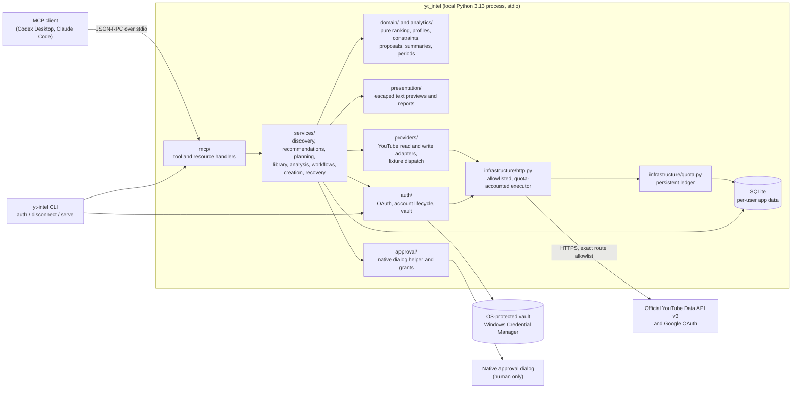
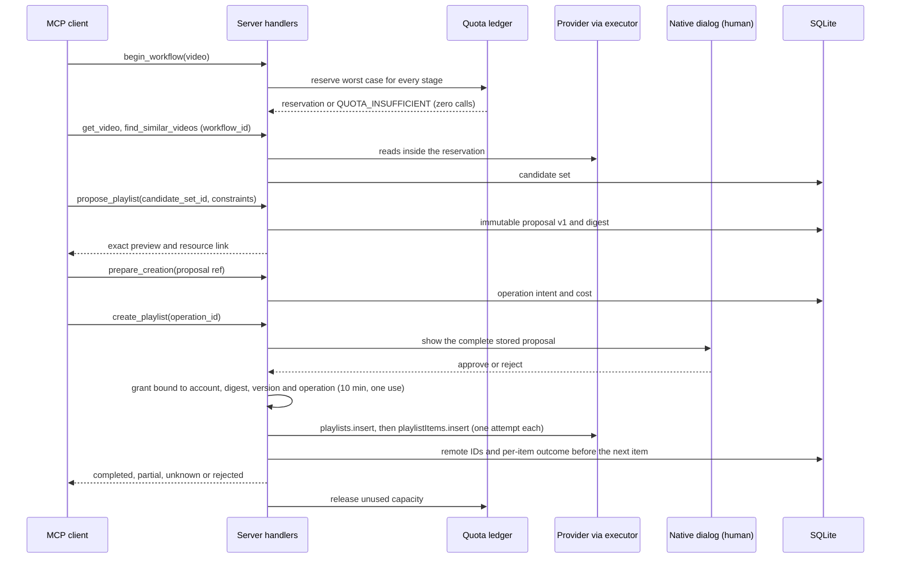
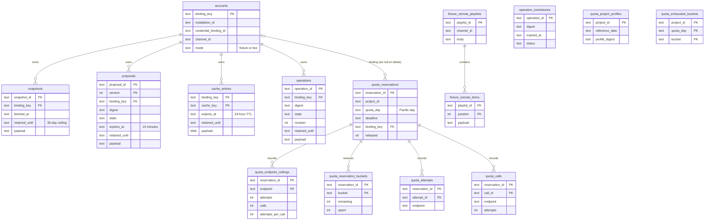

# Architecture and data model

28 November 2026 · Release evidence for GOV-04 and AT-20 · Drawn from the code on the release-candidate branch

This page shows the system as built. The planning diagrams in the
[master plan](../implementation/MASTER_PLAN.md) and the
[contracts](../implementation/CONTRACTS.md) record the design. Where they
differ, the code and this page win. Design decisions are in the
[ADRs](../adr/).

## Components

- **Pure core.** `domain/` and `analytics/` have no I/O.
- **One network path.** Only `AccountedHttpExecutor` reaches the network.
  It debits the ledger before every attempt.
- **Fixture mode.** The fixture provider puts an `httpx.MockTransport` behind
  the same executor. Fixture runs therefore exercise the real accounting,
  retry and error-translation code.
- **Approval.** Approval grants are created only from the native dialog's
  decision, and only inside the server.

## Composed video-to-playlist workflow

## Data model

These tables come from the migrations in
[`database.py`](../../src/yt_intel/infrastructure/database.py).
`payload` columns hold validated contract JSON.

- **Disconnect.** Deleting an `accounts` row cascades to its snapshots,
  proposals, cache entries and operations.
- **What survives disconnect.** Quota reservations keep their spend, with
  `binding_key` set to null. `operation_tombstones` also stay, so
  disconnecting cannot restore quota or allow a replay.
- **Fixture-only tables.** `fixture_remote_*` holds the simulated remote
  playlists for fixture runs only.
- **Secrets.** Tokens never appear in any table. They live only in the OS
  vault.
