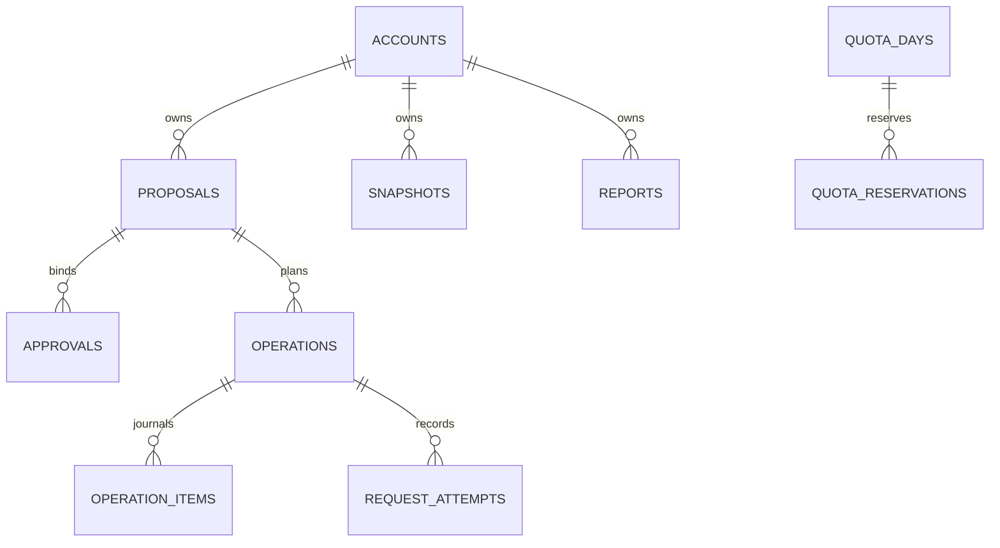

# Shared implementation contracts

Version 1.0 · 16 November 2026 · Owner: Aadyant · Status: design, implementation pending

Read with [MASTER_PLAN.md](MASTER_PLAN.md) and [TEAM_WORKPLAN.md](TEAM_WORKPLAN.md). A01 turns these contracts into validated models and fixture examples. Consumer work starts after that contract PR is merged. Future changes require an explicit contract PR, affected-owner review and updated examples/tests. No implementation is claimed here.

Basis: [MCP contracts](../../brain/resources/11-mcp-and-agent-skill-contracts.md), [approval](../../brain/resources/06-preview-and-human-approval.md), [partial writes](../../brain/resources/07-playlist-writes-and-partial-failure.md), [planning boundaries](../../brain/resources/15-implementation-boundaries-and-contracts.md).

## 1. Shared rules

- Version the application schema as `1`; include it in results and persisted payloads. Do not confuse this with negotiated MCP protocol version.
- Inputs forbid unknown fields, reject booleans as integer durations/limits, and validate lengths/IDs/positive values before any provider request. Bound text and collection sizes; do not accept NaN/infinite scores.
- Store datetimes as aware UTC; API parsing preserves the original timestamp basis. Public formats are RFC 3339 with an explicit timezone. Reject naive dates and overlapping/invalid period ranges with corrective guidance.
- All business duration values are integer seconds. Presentation may include `H:MM:SS`; rounded strings never feed constraints.
- Missing evidence is `null` plus a reason/evidence status. Missing is never zero, English, available, consented or complete by default.
- Account binding is derived from the active credential/channel, not trusted from a model's `account_id` argument. IDs locate objects; they do not authorise access.
- Every private object uses `(installation_id, credential_binding_id, channel_id, mode)` as its binding. Reauthorisation to the same verified channel may preserve the binding only through the account service; switching identity invalidates pending authority.
- Fixture and live modes are explicit in every result. Live provider objects cannot be injected through a tool argument.

## 2. Shared models

These are model field requirements, not copy-paste executable class definitions. A01 supplies actual enums, validators and JSON examples.

| Model | Required fields and semantics |
| --- | --- |
| `Video` | `video_id`, `channel_id`, title, channel title, canonical URL, description, tags (nullable), category ID (nullable), publication time (nullable), `duration_seconds` (nullable), raw audio/metadata language tags, `language_evidence`, availability, live status, `fetched_at`, evidence warnings |
| `Channel` | Channel ID, title, canonical URL, optional handle/description/uploads playlist ID, fetch time; no invented subscriber statistics |
| `ChannelSample` | Channel, ordered sample video IDs, attempted/usable/skipped counts, selection-rule version, sample coverage |
| `Page[T]` | Items, server-internal provider next-page token, API-reported total if available, omitted/inaccessible counts and reason codes; total is an estimate, not completeness proof |
| `Coverage` | `complete`, `paginated`, `sampled`, `truncated` as separate booleans; retrieved/usable/inaccessible/unknown counts; limits; sampled sources; `completeness_basis`; safe continuation reference and warnings |
| `PlaylistOccurrence` | Playlist ID, playlist-item ID, video ID, position, `added_at` from playlist-item snippet, accessible/unknown state; distinguish occurrence from unique video |
| `SubscriptionSignal` | Subscription ID, subscribed channel ID, `subscribed_at`, optional bounded topic sample, coverage; sample is not an engagement event |
| `LibrarySnapshot` | Snapshot ID/binding, fetch times, likes map, subscription signals, owned-playlist selection and occurrences, normalised video map, per-source coverage/denial state, retained-until timestamp |
| `RankedVideo` | Rank, Video, full application score, ranking version, reason/evidence fields, matched terms, unknown-field warnings and supporting preference sources where applicable |
| `RankedChannel` | Rank, ChannelSample, application score/version, explanation and sample limitations |
| `CandidateSet` | ID/binding, ordered unique hydrated candidates, source/seed/topic, coverage, ranking/config versions, creation/expiry times; clients reference this rather than supplying computed evidence |
| `PlaylistConstraints` | Non-empty topic, positive total/individual seconds, valid requested language tag, `duration_mode=max`; explicit exact-fill input yields clarification/unsupported error |
| `PlaylistProposal` | ID/version/binding, candidate-set reference, title/description/privacy, constraints, ordered item evidence snapshots, total/unused seconds, exclusions, warnings, algorithm versions, digest, creation/expiry times, proposal state |
| `ResumeProposal` | New immutable proposal identity/digest/expiry, original operation/proposal/digest/binding, verified project-created playlist ID/current state, verified existing prefix, exact missing suffix/evidence and full constraints; authorises insert-only recovery |
| `HumanDecision` | Internal helper challenge/response reference, proposal digest/version, operation ID, binding, approve/reject, observed time; never accepted as an MCP input |
| `ApprovalGrant` | Internal grant ID, binding, proposal digest/version, operation ID, source=`native-human`, created/expiry/consumed times; single-use and non-exportable |
| `Operation` | Opaque server-issued operation ID, binding, proposal identity/digest, execution state, remote playlist ID (nullable), per-item progress and IDs, safe result/error, timestamps and retention limit |
| `WorkflowPlan` | Plan ID, binding/project ID, quota-profile ID, endpoint call/attempt ceilings, bucket vector, candidate/page/sample ceilings, deadline, cancellation policy, reconciliation allowance |
| `WorkflowSession` | Opaque ID/binding, workflow kind, composed plan/reservation ID, allowed stage transitions, spent/remaining ceilings and idle expiry; no client-supplied cost estimate |
| `AnalysisReport` | Report ID/binding, snapshot ID, report version, per-source and unique populations, counts/denominators, runtime statistics/bands, period comparisons, unknowns, timestamps/evidence basis and coverage |

If an API response omits a video entirely, the provider reports an omitted ID; it does not invent a `Video` containing a guessed title or status. Known private/deleted placeholder entries are preserved as inaccessible occurrences. `Coverage.complete=true` means the declared requested population was exhausted, never the entire account lifetime; `completeness_basis` names provider cap/budget/sample scope. Count inaccessible and unknown separately when the provider cannot establish why an ID was omitted.

Page continuation handles are opaque account-bound random IDs with expiry pointing to private server state. They bind original request/config/snapshot; a changed request cannot resume another user's pagination. Do not return raw Google page tokens, credentials, file paths or serialised internal state. Each resumed workflow needs its own quota preflight. Avoid duplicating items across resumed pages; report if a changed upstream population prevents a consistent snapshot.

### Analytics contract for Jeswin

`summarise_library(snapshot, config) -> AnalysisReport` and `compare_periods(snapshot, period_a, period_b) -> PeriodComparison` are pure functions. No source traversal or hydration occurs inside analytics. The service layer validates policy/account/snapshot expiry before calling them. Counts must expose `population_kind`, `source`, `count`, `denominator`, `unknown_count`, `deduplication_rule` and `timestamp_basis` where applicable.

The reports contain separate views for likes, playlist occurrences, combined unique videos and subscriptions. Duration statistics use known positive values and explicitly identify that denominator. Empty mean/median and undefined changes use null plus an explanatory code. Top-list ties use ascending stable ID. Publication dates cannot be passed as event timestamps by coercing a field name.

Presentation functions accept public DTOs and return readable text only: `render_ranked_results`, `render_proposal`, `render_report`, `render_error`. They do not mutate DTOs, infer evidence, recalculate authoritative totals or assign approval. For large previews, show all 50 items in scrollable/pages of content rather than dropping items. Escape metadata for the target surface and label synthetic mode.

## 3. Provider and infrastructure boundaries

The `YouTubeProvider` is an async interface implemented by `LiveYouTubeProvider` and `FixtureYouTubeProvider`. Every method receives a `RequestContext` with the bound account, workflow reservation, deadline and cancellation token; no method accepts a bearer token supplied by a client. The live implementation obtains protected credentials internally.

| Method shape | Result |
| --- | --- |
| `get_videos(ctx, video_ids)` | Video map plus omitted IDs; split into accounted API batches internally |
| `resolve_channel(ctx, ChannelRef)` | Resolved channel or typed unavailable/invalid error |
| `get_channels(ctx, channel_ids)` | Channels and omitted IDs |
| `get_my_channels(ctx)` | Current credential's possible channel bindings |
| `search_videos(ctx, query, page_size, page_token, language_hint)` | Page of candidate IDs and search evidence |
| `list_likes(ctx, page_size, page_token)` | Page of authorised video metadata |
| `list_subscriptions(ctx, page_size, page_token)` | Page of subscription signals |
| `list_my_playlists(ctx, page_size, page_token)` | Page of owned playlist metadata |
| `list_playlist_items(ctx, playlist_id, page_size, page_token)` | Page of playlist occurrences |
| `get_category_labels(ctx, region_code)` | Category ID/label map |
| `create_playlist(ctx, ApprovedWriteContext, ExactPlaylistBody)` | New playlist ID and returned state |
| `insert_playlist_item(ctx, ApprovedWriteContext, playlist_id, video_id, position)` | Remote playlist-item ID and position |

`ApprovedWriteContext` is internal, created only by the creation/recovery service after an atomic operation claim and approval consumption. It carries operation/reservation identity and exact allowed request digest. It is not reconstructible from deserialised MCP input. The low-level request executor additionally checks method/endpoint/body membership against the execution plan. Type hints alone do not enforce authority; runtime validation and repositories do.

The provider performs API mapping, response normalisation and typed error translation. The HTTP executor handles allowlisted hosts, HTTPS, authentication header injection, debit-before-dispatch, attempt timeouts and safe read retries. Disable transport/library automatic retries, redirects and unrestricted environment proxy routing unless explicitly documented and validated. Retry only timeout/429/selected 5xx reads within three total attempts and remaining deadline. Honour bounded Retry-After; do not retry quota/permission/invalid-input failures or writes. A retry consumes reservation before dispatch.

Only allow `www.googleapis.com/youtube/v3` (exact route/method allowlist), Google OAuth authorisation/token/revocation destinations configured from verified official documentation, and the local OAuth callback. Reject userinfo, off-host redirects, arbitrary URL requests, discovery downloads from unplanned hosts and alternate methods. OAuth library network use receives the same timeout/redaction policy even though it is not charged YouTube quota.

The fixture provider implements the same surface and emits an audit list of attempted method/IDs/costs for assertions. Paul supplies API-shaped payloads and manifests; Aadyant owns the normalising fixture adapter and call/error script interpreter. Neither can read live credentials or silently fall through to the live provider. Fixtures support deterministic pagination, injected errors at chosen attempts, timeouts, omitted content and write-before-timeout outcomes.

Other replaceable interfaces: `Clock`, `TokenVault`, `ApprovalAdapter`, `QuotaLedger`, `ProposalRepository`, `OperationRepository`, `CacheRepository`. Fake clocks/vaults/approval adapters are test dependencies built by test code. A `testing=true`, `approved=true` or `auto_confirm` runtime option must not enable a fake authority path in live mode.

## 4. MCP tool surface

Tool names below are the v1 application contract. Result schemas use explicit Pydantic models. Mark read-only tools accordingly and creation as a write in annotations; annotations are client hints and never the server's authorisation check.

| Tool | Model-controlled inputs | Output and side effect |
| --- | --- | --- |
| `begin_workflow` | Server-defined workflow kind, bounded user request and optional seed/constraints | Composed worst-case reservation and opaque workflow ID before any provider call; no writes |
| `get_video` | `video` URL/ID | Normalised video and coverage; read-only; local-check fetch tool |
| `find_similar_videos` | `video`, `limit=10` | Ranked videos plus candidate-set reference |
| `find_similar_channels` | `channel` URL/handle/ID, `limit=10` | Ranked sampled channels |
| `get_library` | Source subset (default all 3), optional server-issued continuation | Snapshot summary/reference, source coverage; no unrequested raw private library dump |
| `recommend_videos` | Optional topic/total/individual/language filters, `limit=10`, optional snapshot reference | Explained recommendations and profile-source coverage; validation/clarification as needed |
| `analyse_library` | Optional snapshot reference, source subset, optional two periods | Analysis report/reference and readable explanation |
| `propose_playlist` | Constraints, title, privacy=`private`, optional seed/candidate-set reference | Complete proposal ID/version/preview, no writes |
| `revise_proposal` | Proposal ID/version and explicit new request fields | New version; prior grant invalidated; no writes |
| `prepare_creation` | Proposal ID/version | Server-issued operation ID, current preview and authority prerequisites; no writes |
| `create_playlist` | Proposal ID/version, server-issued operation ID | Native human interaction, then guarded writes or safe refusal; no approval argument |
| `get_operation` | Operation ID | Bound recorded status, partial/unknown state and safe advice |
| `reconcile_operation` | Operation ID, optional human-identified remote playlist ID | Bounded verification reads only; cannot resume/create/delete |
| `resume_operation` | Operation ID | Fresh native approval of verified missing items, guarded insertions to verified playlist only |
| `get_account_status` | None | Current non-secret channel/scope/authorisation status, local setup guidance |
| `get_quota_status` | None | Local estimated bucket balances/profile/reset; no provider call |
| `disconnect_account` | None | Disable new workflows, revoke best effort, clear local account data; report each result |

Networked tools also accept an optional opaque `workflow_id`. The server validates that the tool/stage, parameters, account, expiry and remaining call ceilings belong to that session. A declared composed skill must start its complete reservation before the first fetch and pass this ID throughout. A standalone tool without a session auto-reserves its complete service workflow. Session costs/allowed endpoints are derived by server code, never accepted from model-supplied accounting. Reusing or escalating a session cannot escape the original plan.

Actual account authorisation is a local operator CLI action, `yt-intel auth --read` or `yt-intel auth --enable-writes`, opening Google's browser flow. The client can present these commands but cannot ask for credential paste. Do not expose a model-controlled token setter or arbitrary OAuth URLs. Disconnect is an intentional user-requested tool action; it changes local access, not YouTube playlist contents. Successful disconnect cancels/drains in-flight work before deletion; report a failure if a dispatch cannot yet be resolved safely.

The server owns an instance lock for the runtime store and serialises account changes and write operations. If another process uses the same store/project, coordinate shared quota through SQLite and refuse conflicting live account ownership. Reads can be concurrent inside bounded limits. Replays during creation return the operation's recorded state and never trigger a second execution.

### Input example, not a created proposal

```json
{
  "topic": "database indexing",
  "total_seconds": 7200,
  "max_video_seconds": 1200,
  "language": "en",
  "duration_mode": "max",
  "title": "Database indexing study",
  "privacy": "private"
}
```

`create_playlist` rejects unknown inputs such as `confirmed`, `approved`, `grant_token`, `account_id`, `video_ids` or an executable `approval_command`. Fetching/creating never trusts durations, output scores or an account name generated by the client.

### Output envelope

```json
{
  "schema_version": "1",
  "mode": "fixture",
  "request_id": "synthetic-request-01",
  "status": "ok",
  "data": {},
  "warnings": [],
  "coverage": null,
  "error": null,
  "quota": {"estimated": true, "profile_id": "youtube-2026-11-16"}
}
```

`status` is `ok`, `empty`, `partial`, `blocked`, `error` or `unknown`. Structured content uses the tool's declared output schema; companion text is rendered from that same object. Domain failures have a non-null error with stable code/message/retryable/safe-next-action and `isError=true` when represented as an MCP tool failure. A partial remote write remains an explicitly partial operation payload with URL/progress; it must not be flattened into an unqualified success. Protocol-level errors remain SDK/protocol errors. No stack traces or credentials in either path.

Minimum stable error codes: `INVALID_INPUT`, `UNSUPPORTED_IDENTIFIER`, `CONTENT_UNAVAILABLE`, `INSUFFICIENT_DATA`, `CLARIFICATION_REQUIRED`, `NO_FEASIBLE_PLAYLIST`, `AUTH_REQUIRED`, `SCOPE_REQUIRED`, `AUTH_REVOKED`, `CHANNEL_REQUIRED`, `ACCOUNT_MISMATCH`, `POLICY_BLOCKED`, `QUOTA_INSUFFICIENT`, `QUOTA_EXHAUSTED`, `RATE_LIMITED`, `WORKFLOW_TIMEOUT`, `PROVIDER_UNAVAILABLE`, `APPROVAL_REQUIRED`, `APPROVAL_REJECTED`, `APPROVAL_EXPIRED`, `PROPOSAL_CHANGED`, `OPERATION_CONFLICT`, `OPERATION_UNKNOWN`, `OPERATION_RESULT_EXPIRED`, `PARTIAL_WRITE`, `VERIFICATION_PENDING`, `LOCAL_DELETION_FAILED`.

## 5. MCP resources

| URI | Data and guard |
| --- | --- |
| `yt-intel://help` | Non-secret features, limits, metadata evidence and fixture/live explanation |
| `yt-intel://quota` | Local estimated bucket balances; does not fetch Cloud console data |
| `yt-intel://skills/{name}` | Allowlisted canonical SKILL.md content; no arbitrary file paths |
| `yt-intel://proposals/{proposal_id}/{version}` | Complete preview for current binding and unexpired version |
| `yt-intel://reports/{report_id}` | Bound report with retention/coverage; reject foreign or expired IDs |
| `yt-intel://operations/{operation_id}` | Bound operation status, URL/progress and safe recovery advice |

Discovery lists only accessible current objects, with bounded paging if needed. Resource reads run the same account/mode/expiry checks as tools. Guessing a UUID cannot expose another account. A skills URI cannot escape its fixed directory or expose `.env`, runtime DB or other files. Account-specific URIs contain opaque IDs, not email/channel credentials.

## 6. SQLite state design

Use explicit SQL migrations with a schema version, foreign keys and short transaction scopes. WAL mode and busy timeouts support concurrent reads and atomic writes; never hold a transaction across HTTP, OAuth or a human dialog. Store canonical JSON payloads alongside typed key/status/time columns where useful. Migrate safely and back up only non-secret synthetic development data in tests; live backups follow the same retention policy.

| Table | Main keys/constraints and purpose |
| --- | --- |
| `accounts` | Internal binding PK, installation/mode/channel unique binding, vault reference, scope summary, connected state; no tokens |
| `snapshots` / `reports` / `candidate_sets` | Object ID, binding FK, version/config/fetch/expiry, bounded payload and coverage |
| `proposals` | `(proposal_id,version)` PK, binding FK, digest, payload, state, created/expiry; immutable version content |
| `approvals` | Grant ID PK, binding/proposal/version/operation relation, authority digest, source, expiry, consumed_at; retain historical grants and enforce at most one current unconsumed grant per operation; no client-minted records |
| `operations` | Server ID PK, binding/digest/proposal, state, remote playlist ID, times and last safe error; unique idempotency identity |
| `operation_items` | `(operation_id,index)` PK, video ID, request digest, remote item ID, intent/response/status; unique approved video per operation |
| `request_attempts` | Attempt ID, operation/workflow, method, request digest, dispatch/response state, cost; no auth headers or raw private payload |
| `quota_days` | `(cloud_project_ref,profile_id,reset_period,bucket)` key, limit/used/reserved/exhausted; project ref is local non-secret identity |
| `quota_reservations` | Reservation ID, workflow/project/period/profile, bucket amounts, lifecycle and dispatch accounting |
| `workflow_sessions` | Opaque ID, binding, kind, composed plan/reservation, stage, expiry and remaining bounded calls; invalidate on account/config change |
| `cache_entries` | Binding/mode/provider/version/request digest key, fetch/TTL/hard-delete times, minimal normalised payload |
| `operation_tombstones` | Expired opaque ID/digest/status without retained API payload; refuse replay after detailed result removal |



Conceptual ER diagram: a proposal means its compound ID/version; the SQL migration supplies that exact foreign key. Quota reservations are project-scoped, independent of personal rows. Do not cascade account deletion into quota balances and thereby restore quota. Cleanup must remove operation data while preventing expired-ID replay; see the master retention policy.

### State separation and transaction rules

Proposal states: `proposed`, `approved`, `rejected`, `expired`, `superseded`. An approved proposal's grant is still tied to exactly one operation. Changing content creates a new proposed version and supersedes the prior version; it does not update the approved payload in place.

Operation states: `not_started`, `awaiting_approval`, `preflighting`, `creating`, `completed`, `partial`, `unknown`, `verification_pending`, `rejected`, `expired`, `failed_preflight`, `failed`. `failed_preflight` precedes writes; `failed` is a definitive rejection after dispatch with no remote creation established. Per-item states: `pending`, `intent_recorded`, `acknowledged`, `unknown`, `verified_present`. Known insertion failure after earlier successful items becomes partial; an uncertain response becomes unknown. No creation retry may originate from unknown until reconciliation has established safe state.

Store creation and resume proposals with explicit purpose and their own immutable authority digests. A resume proposal expires independently of the original preview and binds the original digest, verified remote playlist/prefix and remaining suffix. Approval history can contain multiple consumed grants for one operation across supervised recovery attempts; only the new current grant may permit its exact remaining insertions. Do not require an expired original grant to become valid again, and do not reuse the original create permission for recovery.

Atomic operations include: quota reserve/consume/release; proposal revision plus grant invalidation; operation-ID claim; grant consumption plus transition to creating; persisting intent before remote dispatch; storing returned IDs before moving to the next item. Preflight failure updates operation state and releases unused amounts but never calls a write. Crash tests cover every boundary, including between remote acceptance and saving the returned ID.

## 7. Configuration and future command contract

`config/defaults.toml` is non-secret. It names fixture/live mode, caps, deadlines, cache/retention, log level, approved host/routes, quota-profile path, region and policy status reference. Credentials are separate local operator configuration. A model cannot set `policy_resolved=true`, approval source, live mode, account binding or budget through tool arguments.

Planned commands, implemented by the corresponding tasks:

| Command | Purpose |
| --- | --- |
| `python -m yt_intel serve --provider fixture` | stdio MCP fixture server; stdout protocol only |
| `python -m yt_intel auth --read` | Operator Google read consent through local browser |
| `python -m yt_intel auth --enable-writes` | Operator write-scope consent and same-channel verification |
| `python -m yt_intel doctor` | Non-secret runtime/backend/config diagnostics |
| `python -m pytest -m "not live"` | Offline suite with denied outbound network |
| `python scripts/validate_knowledge.py` | Notes, skills, unique stems, links and traceability |
| `python scripts/evaluate_skills.py --mode fixture` | Repeatable skill cases with individual observed statuses |
| `python scripts/check_local.py --provider fixture` | Five-step local-check with process cleanup |

No command is asserted to exist yet. `serve --provider live` is operator configuration only after prerequisites, never a model's mode override. There is no `--yes`, `--approved`, `--auto-confirm` or headless live write command.
