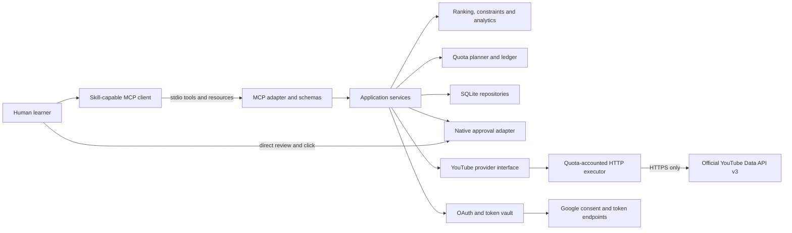
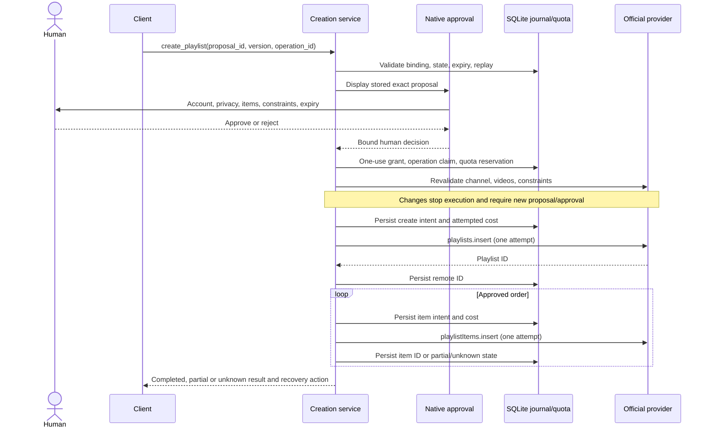
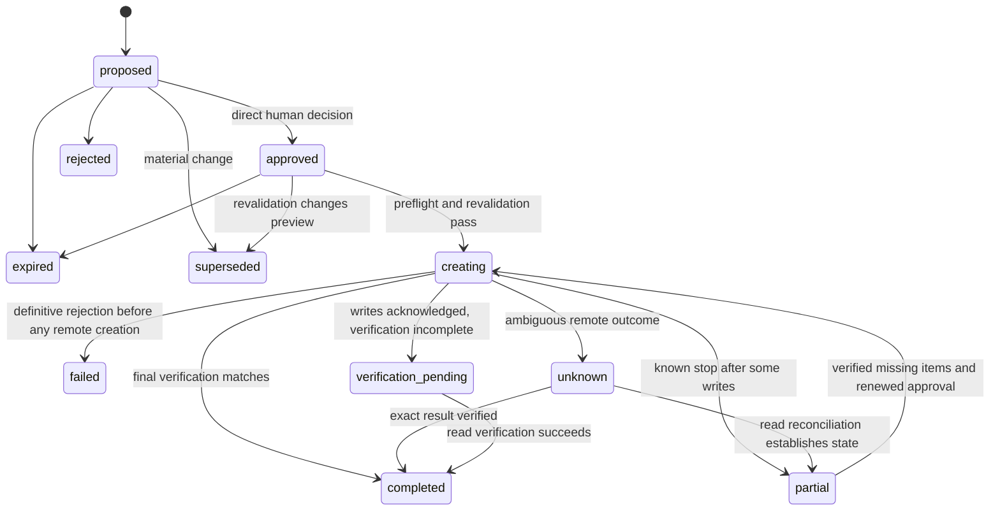

# YouTube Video Intelligence MCP Server: implementation master plan

Version 2.0 · 19 November 2026 · Team Random Stuff · Author: Codex

Status: local implementation proposal, ready for team review. This is a design and work plan, not an implementation, passed test report, human approval, or changed SRS. The user revised the allocation on 19 November: divide engineering equally among Aadyant, Jeswin and Paul, including complex production work, tests, documentation, integration and review. This supersedes the earlier allocation and chat prompts; use the version 2 task IDs.

## 1. How to use this plan

Read [the SRS](../requirements/SRS.md) first. Its 46 numbered requirements, FR-1 through FR-5, AT-01 through AT-20 and TQ-1 through TQ-8 remain binding. The IEEE and compact renditions preserve the same numbered baseline; this plan does not rewrite any of them.

The execution documents are:

| Document | Purpose |
| --- | --- |
| [CONTRACTS.md](CONTRACTS.md) | Shared models, provider boundary, tools, resources, error and state contracts |
| [TEAM_WORKPLAN.md](TEAM_WORKPLAN.md) | Owned tasks, estimates, dependency order, review and delivery gates |
| [coverage.csv](coverage.csv) | One current-owner/task planning row for each of the 46 numbered requirements |
| [tasks.json](tasks.json) | 24 current tasks, equal effort ranges and explicit dependencies |
| [TASK_MIGRATION.md](TASK_MIGRATION.md) | Retired-task mapping and new starting prompts/order |
| [PLAN_QA.md](PLAN_QA.md) | Observed planning integrity checks and remaining evidence limits |
| [Aadyant brief](roles/AADYANT.md) | Ranking/recommendations/planning, MCP and presentation engineering |
| [Jeswin brief](roles/JESWIN.md) | HTTP/provider/OAuth/library/analytics and privacy engineering |
| [Paul brief](roles/PAUL.md) | Persistence/quota/approval/write/recovery and CI engineering |
| [root AGENTS.md](../../AGENTS.md) | Mandatory instructions for all coding agents |
| [ADRs](../adr/) | Reviewable decisions and consequences |

Names and paths below describe planned files unless they already exist. Do not mistake a directory tree, task ID, or future command for an implemented capability. Implementation Issue/PR/test links remain pending until created. The older SRS traceability register remains intact; reconcile it with this planning register as real work lands.

Decision basis: [metadata similarity](../../brain/resources/02-metadata-based-similarity.md), [approval](../../brain/resources/06-preview-and-human-approval.md), [quota](../../brain/resources/09-quota-buckets-and-budgeting.md), [engineering workflow](../../brain/resources/12-engineering-and-knowledge-workflow.md), and [implementation boundaries](../../brain/resources/15-implementation-boundaries-and-contracts.md), and [equal allocation](../../brain/resources/17-equal-team-allocation.md).

## 2. Product boundary and completion target

Deliver one installable local stdio MCP server for one authorised YouTube account/channel per instance, five product features, five repository skills, one demonstrated skill-capable client, and the required engineering evidence. The AI client interprets conversation; the server validates every structured input and enforces all authority, constraint and quota rules.

| Feature | Required implementation | Primary owner |
| --- | --- | --- |
| FR-1 Similar videos | Bounded official-API candidates, deterministic local similarity, reasons and evidence limits | Aadyant |
| FR-2 Similar channels | Resolve IDs/handles, compare descriptions plus bounded video samples | Aadyant |
| FR-3 Recommendations | Likes, subscriptions and playlists; deduplicated profile; explained ranking | Aadyant profile/ranking; Jeswin collection/provider |
| FR-4 Engagement analysis | Collection counts, runtime statistics and supported timestamp comparisons | Jeswin collection and analytics; Aadyant report rendering |
| FR-5 Playlist creation | Clarification, strict planning, complete preview, human approval and recoverable writes | Aadyant planning/preview/product skill; Paul approval/writes/recovery; Jeswin identity/HTTP |

The equal allocation is eight tasks and 56–80 planned hours per member (one third each at midpoint). Aadyant owns algorithms/planning/MCP/presentation, Jeswin owns provider/identity/library/analytics, and Paul owns state/quota/authority/execution/recovery. All three supply their own fixtures/tests/docs/integration and review another track. See the team workplan for checkpoints and handoffs.

No custom web app, public service, media player, model training, embeddings service, transcripts, downloads, scraping or extra account mutation belongs in this baseline. Do not build a REST API just to connect the modules; stdio is the product interface. The native confirmation dialog is a narrow approval control, not a second application.

Natural-language ambiguity is handled before proposal construction. The client asks for missing topic, total upper bound, individual upper bound, and language; exact-fill requests need clarification or an explicit unsupported response. Public/private/unlisted is validated, with private as the default. Creation is never implied by a request to find, rank, analyse or propose.

## 3. Technology decisions

| Layer | Choice | Reason and implementation condition |
| --- | --- | --- |
| Runtime | CPython 3.13; existing local interpreter is 3.13.1 | Already available on Aadyant's Windows machine; use an isolated project environment |
| Package | `src/` Python package named `yt_intel`, `pyproject.toml`, console entry point `yt-intel` | Explicit imports, installable wheel, repeatable commands |
| MCP | Official `mcp` Python SDK; planning baseline `mcp==2.3.0` | PyPI reports this stable release on the reference date; prove stdio/tools/resources compatibility in A2-01 before freezing the lock [S1, S2] |
| Validation | Pydantic v2, strict domain validators | Central machine-readable contracts, unknown-field rejection and JSON schemas |
| YouTube transport | `httpx.AsyncClient` calling official REST v3 endpoints | One explicit request boundary for quota, timeouts and retry accounting; no hidden SDK retries |
| OAuth | `google-auth-oauthlib` + `google-auth[requests]` | Installed-app flow, PKCE/state checks and credential refresh through Google libraries [S3, S4] |
| Persistence | Standard-library SQLite, short transactions, schema migrations | Durable proposals, operation journal, cache and atomic quota reservation without a database service |
| Secrets | `keyring` with a verified Windows protected backend | Tokens are kept out of SQLite and the repository; reject plaintext or unavailable backends in live mode [S5] |
| Approval UI | Python `tkinter` helper in a separate process | Native human interaction independent of model tool arguments; P2-03 proves availability/lifecycle with Aadyant's preview/client shell |
| Ranking | Versioned sparse TF-IDF/cosine and simple weighted scores implemented over bounded data | Explainable, deterministic and sufficient at 200 candidates; no PyTorch, GPU or remote model dependency |
| Time and data | `datetime`, `zoneinfo`, `statistics`, `decimal` where needed; `tzdata` for Windows | Exact seconds; explicit UTC intervals; Pacific quota reset with DST |
| Paths and config | `platformdirs`, `tomllib`, Pydantic settings models | Per-user runtime state outside the checkout; validated, non-secret TOML profiles |
| Tests | `pytest`, AnyIO test support, `pytest-cov`, HTTPX mock transport; Hypothesis for constraints/state invariants | Offline domain, transport, persistence and MCP system verification |
| Quality/build | Ruff, mypy, `build`, pip-tools; pinned secret scanner | Repeatable lint/type/package/secret checks and a resolved dependency lock |
| CI | GitHub Actions, Windows reference job plus Linux fixture job | Windows-native approval/secret integration is verified separately from portable fixture tests |
| Documentation | Markdown, Mermaid UML/state/ER diagrams, CSV traceability, versioned SKILL.md folders | Reviewable source artefacts; no additional authoring service required |
| Demonstration client | Claude Code local client, subject to A2-05/P2-03 compatibility proof | Official docs cover local stdio MCP and project skills; native server confirmation remains mandatory [S13, S14] |

Only the MCP release above was a specifically verified package selection in the original 16 November technical research. This 19 November revision changes allocation and has not reverified upstream release/API facts. Other package names and major families are choices, not invented exact release numbers. A2-01 must resolve compatible, non-prerelease versions on Python 3.13, inspect SDK-version-specific APIs, record them in `docs/developer/dependencies.md`, and commit hashed runtime/dev locks. Do not mix v1 FastMCP examples with the selected v2 `MCPServer` API. A tested ADR update is required if the chosen SDK cannot satisfy the SRS protocol contract.

The MCP reference is the SRS's 2025-11-25 protocol revision; negotiate supported capabilities and prove actual interoperability rather than asserting SDK release equals protocol version. No OpenAI/Anthropic model API key is required by the server. The user supplies their chosen AI client's existing access; client-specific costs are external prerequisites, not guaranteed free service.

### Environment setup policy

Inspect an existing `.venv` before modifying it. The checked local interpreter is `C:\Users\Aadyant Neog\AppData\Local\Programs\Python\Python313\python.exe`. This project does not need ML dependencies; use a normal isolated `.venv` created from that interpreter. Do not install or alter PyTorch. Each teammate uses their own Python 3.13 path, account and virtual environment, never Aadyant's absolute path copied into shared runtime configuration. Record the CI patch version once verified.

Planned bootstrap after A2-01 creates the actual manifests:

```powershell
& 'C:\Users\Aadyant Neog\AppData\Local\Programs\Python\Python313\python.exe' -m venv .venv
& '.\.venv\Scripts\python.exe' -m pip install --require-hashes -r requirements-dev.lock
& '.\.venv\Scripts\python.exe' -m pip install --no-deps --no-build-isolation -e .
```

The dev lock includes pinned build-backend requirements so the editable install does not resolve untracked packages. Wheel building uses the same locked environment; test that wheel in a clean environment installed from the runtime lock. These commands are future setup instructions, not actions run by either planning revision.

## 4. Architecture and trust boundaries

Use a modular monolith. Keep external traffic, persistence and interactive approval behind interfaces. Domain functions receive normalised objects and return typed results; they never call YouTube, open a dialog, inspect environment variables or mutate approval state.



The diagram is a component view. Its permission boundaries are enforced in code: tools cannot construct grants; domain/analytics cannot access a provider; only the executor performs network requests; only creation/recovery services can call provider write methods after authorisation.

Recommended structure:

```text
src/yt_intel/
  __main__.py, cli.py, config.py, bootstrap.py
  contracts/      models.py, errors.py, provider.py, approval.py
  domain/         identifiers.py, durations.py, language.py
                  ranking.py, profiles.py, constraints.py, proposals.py
  analytics/      summaries.py, periods.py                 # Jeswin
  presentation/   results.py, previews.py, reports.py      # Aadyant
  services/       discovery.py, library.py, recommendations.py
                  analysis.py, planning.py, creation.py, recovery.py
  providers/      youtube.py, fixture.py                 # Jeswin read/dispatch
                  youtube_writes.py, fixture_writes.py  # Paul write adapters
  infrastructure/ http.py, quota.py, database.py, repositories.py
                  cache.py, clock.py, redaction.py
  auth/           oauth.py, vault.py, account.py
  approval/       desktop.py, dialog.py
  mcp/            server.py, resources.py, discovery.py, planning.py  # Aadyant
                  library.py                           # Jeswin
                  execution.py                         # Paul
config/           defaults.toml, quota-profiles/youtube-2026-11-16.toml
tests/
  unit/, integration/, system/, security/, performance/, live/
  fixtures/       youtube/, libraries/, failures/, expected/
  skills/
scripts/          validate_knowledge.py, evaluate_skills.py, check_local.py
.agents/skills/   brain-ingest/, brain-refine/, brain-query/
                  local-check/, video-to-playlist/
docs/             implementation/, adr/, developer/, user/, evidence/
.github/          workflows/, CODEOWNERS, pull_request_template.md
```

Existing SRS-generation scripts stay in place. No implementation directory should acquire placeholder code that pretends to pass acceptance. Each member owns the substantial track and handler integration in their brief. Aadyant supplies common composition/contracts; Jeswin supplies HTTP/read provider/account/library/analytics; Paul supplies state/quota/approval/write/recovery. All three own their feature tests, fixtures, docs and integration fixes. Shared files have a named editor and affected-owner review per PR.

### Operational defaults

| Setting | Initial design value |
| --- | --- |
| Provider | `fixture`; live requires explicit operator configuration |
| Result limit | 1–50, default 10 |
| Candidate video cap | 200 unique videos, configurable and included in workflow plans |
| Playlist size | 1–50 unique eligible videos |
| Search discovery budget | At most 4 pages/queries combined per default video workflow |
| Channel comparison sample | Up to 10 channels, 5 videos each, deterministic selection |
| Library page budget | 12 source pages per snapshot, 4 initially allocated to each signal family |
| Provider page size | Up to 50 where the endpoint permits it; request the explicit value |
| HTTP attempt timeout | 15 seconds default, capped by the remaining workflow deadline |
| Foreground read/plan deadline | 60 seconds, including retries and backoff |
| Read attempts | 3 total maximum, bounded backoff and jitter |
| Write attempts | 1; uncertain outcomes must be reconciled |
| Cache TTL | 24 hours; 30 days is an absolute API-data retention ceiling |
| Proposal validity | 10 minutes from construction; revisions create a new version |
| Approval validity | At most 10 minutes and never beyond proposal expiry; one operation |
| Creation | Serial items; separate cancellable deadline, default 10 minutes after human confirmation |

Caps are design choices within the SRS, not additional promises of full account coverage. Return partial coverage and continuation rather than raising caps automatically. The 200-candidate cap applies to discovery/proposal candidate pools, not a claim that a budget-bounded library is a full history. Cached reads still validate account, expiry, policy mode and schema.

## 5. Workflow planning and official API mapping

Every networked workflow first produces a finite `WorkflowPlan`: endpoint counts, page/sample/candidate ceilings, read retry ceilings, write count, reconciliation allowance, deadline, quota profile and account binding. Reserve the full worst case atomically before its first provider request. Adaptive query values may change, but their count and cost cannot exceed the plan. Cache misses or pagination must never trigger an unplanned extra call.

Define the workflow at the user's requested scope, not merely one HTTP request or one conveniently split tool. A declared end-to-end `video-to-playlist` run uses `begin_workflow(kind=video_to_playlist, ...)` before fetching the seed and carries its opaque workflow ID across fetch, similarity, proposal and creation tools. The server builds a composed cost plan for all phases, including up to 50 final items if constraints are not yet known. Clarify any request that needs a larger bound before starting. A simpler standalone read tool may auto-plan its complete read workflow. A later independent request to create is a new disclosed workflow, not proof that earlier reads were preflighted as a creation run.

Workflow-session reservations bind account/project/profile and fixed stage/call ceilings, expire after a bounded idle interval and cannot be enlarged silently. If the session expires, stop, report the reads/cost already performed, and preflight a clearly identified remaining-work session before further calls. An insufficient initial composed reservation rejects before even the seed fetch. The product skill and AT-13/TQ-6 tests must exercise that case; splitting a multi-tool skill into individually affordable calls does not satisfy full-workflow preflight.

| Need | Official methods and parameters | Important limits |
| --- | --- | --- |
| Fetch videos | `videos.list(part=snippet,contentDetails,status,id=...)` | Hydrate IDs in batches of at most 50; omissions are unavailable/unknown, not fabricated records |
| Resolve channel | `channels.list(id=...)` or `channels.list(forHandle=...)` | Exactly one lookup filter per call; `/c/...` and ambiguous legacy paths get guidance [S8] |
| Account/channel | `channels.list(mine=true)` | Bind the selected channel to the credential set; ambiguity requires operator selection |
| Find candidates | `search.list(type=video,q=...,maxResults=50)` | Search results supply IDs, not trusted duration/language evidence [S9] |
| Channel samples | `channels.list(part=contentDetails)` → uploads playlist → `playlistItems.list` → `videos.list` | Take the first 5 accessible upload entries in returned order, hydrate and describe skipped entries |
| Likes | `videos.list(myRating=like,part=snippet,contentDetails,status)` | Authorised source; API currently caps rated results at 1,000; no reliable like-event timestamp [S6] |
| Subscriptions | `subscriptions.list(mine=true)` plus bounded channel/sample retrieval | Subscription creation time is an event; a subscription is a channel signal [S12] |
| User playlists | `playlists.list(mine=true)` → selected owned playlists → `playlistItems.list` | Preserve item occurrence and addition timestamp; do not enumerate unbounded nested playlists [S11] |
| Category labels | `videoCategories.list` with an explicit region | Optional cached enrichment; preserve category IDs if labels cannot be obtained |
| Create new playlist | `playlists.insert(part=snippet,status)` | Exact approved title/description/privacy; authorised write only [S10a] |
| Populate playlist | `playlistItems.insert(part=snippet)` | Insert serially in approved order, journal remote item IDs [S10b] |
| Reconcile known playlist | `playlists.list(id=...)`, `playlistItems.list(playlistId=...)` | Bounded reads; absence on one response does not prove an uncertain write failed |

OAuth refresh/revocation are official Google identity requests outside YouTube Data API quota, still subject to host restrictions, timeouts and redaction. Browser sign-in may follow Google's own navigation; the server never fetches user-submitted URLs.

### Quota model

Reference profile checked 16 November 2026: 10,000 general units/day and 100 search calls/day, with search consuming 1 search unit per call. Relevant list methods cost 1 general unit; playlist creation and item insertion cost 50 each. Reset uses `America/Los_Angeles` midnight, not a fixed UTC offset. Store profile ID/reference URL/date with accounting [S7]. The separate upload bucket is irrelevant because uploads are excluded.

For buckets `b`, reserve `R[b] = sum(max_attempts[m] * planned_calls[m] * cost[m,b])`. Distinguish three read attempts from one write attempt; include all pagination, hydration, revalidation, category enrichment and any allowed reconciliation reads. Reject if any bucket lacks balance, before any provider call.

Example FR-1 budget: 1 seed read + 4 search requests + up to 4 video hydration batches. With 3 total attempts allowed for every read, reserve **15 general units and 12 search units**. This is a conservative design example, not a measured live request. Fewer requests release unused reservation.

Example creation of 10 approved videos: 1 channel read + 1 hydration batch + 1 final playlist-item verification read, each with 3 attempts, plus 1 playlist write and 10 item writes. Base reservation is **559 general units** (`9 + 50 + 500`). If the plan allows 2 additional reconciliation pages with 3 attempts each, reserve **565** before the first call. No retry allowance is added to writes. For 50 items the same base pattern is 2,559 general units before additional reconciliation allowance.

Use SQLite `BEGIN IMMEDIATE` and compare/update transactions for reserve/spend/release across concurrent requests. Scope the ledger to the Cloud project and reset period, not just the account. Multiple local instances sharing a project must share the ledger or be disallowed; a per-process counter is insufficient. Persist an attempted-call debit **before** dispatch. A crash in that gap may overcount; it must not undercount. After restart, conservatively charge unresolved reservations whose dispatch status cannot be proved, and release only demonstrably unspent amounts. Historical quota accounting cannot be reset by disconnect, account switching or deleting cached metadata.

Provider quota exhaustion from usage elsewhere marks the affected bucket unavailable until reset/operator reconciliation and returns a typed error. The UI states that local remaining quota is an estimate. A profile change requires recalculating unstarted reservations; never convert or roll an old reservation into a new quota day without a transaction. No extra Cloud projects to bypass quota.

## 6. Feature algorithms

### FR-1: similar videos

1. Parse a supported video ID/URL locally. Validate all limits before the provider is touched.
2. Preflight the seed/search/hydration workflow. Fetch the seed; fail explicitly if unavailable.
3. Generate a bounded query from seed title/topic terms. Use a fixed query order and at most the planned search pages. Do not treat descriptions as instructions or follow URLs in them.
4. Deduplicate candidate IDs, remove the seed, cap at 200, then hydrate durations, language and availability.
5. Score and sort using `ranking-v1`. Return no more than the requested 1–50 results with limitations, collection coverage and fetch times.

The shared duration parser accepts the API's day/hour/minute/second ISO 8601 forms and computes exact integral seconds; it does not approximate calendar months/years. Test `PT20M=1200`, `PT20M1S=1201`, `P1DT2H3M4S=93784`, missing/malformed/negative values and zero duration. Unsupported or non-integral metadata duration is unknown with a warning, never rounded into eligibility.

`ranking-v1` is a project decision: normalise text with Unicode NFKC and casefold; tokenize documented Unicode word/technical tokens; preserve meaningful tokens such as C++, C# and version numbers; use a versioned small stop-word list. Bound title/description/tag text lengths before processing. Fit a single vocabulary over seed plus candidate documents. Use `tf = 1 + ln(count)`, `idf = ln((1+N)/(1+df)) + 1`, then L2-normalise. Empty vectors have cosine zero.

Build one text document per video using title repeated 3 times, description once, and tags twice. Compute `score = 0.90 * text_cosine + 0.10 * same_category`, renormalising to text only if either category is unknown. Zero text overlap does not become topical solely from a category match: exclude those candidates with a reason. Order by full-precision descending score, then ascending video ID; round scores only for display. Evidence includes matched terms, category evidence and missing fields. Scores are application estimates, not YouTube recommendations or quality ratings. Test topical matches against curated mismatches; tune only through a versioned change and corresponding fixtures.

### FR-2: similar channels

Resolve the seed using IDs/handles. Discover candidate channels from bounded topic-based video search, deduplicate channel IDs and exclude the seed. Hydrate at most 10 candidates by default; the requested result limit remains 1–50, so a larger requested limit may legitimately return fewer results with the sample cap stated. A configured larger pool needs a correspondingly larger preflight and must remain within candidate/deadline limits.

Fetch descriptions and up to 5 upload entries per channel, including the seed, using their uploads playlists. Fix sample selection as the first returned accessible entries within that page; do not keep fetching until five are found. Rank aggregate channel descriptions plus sampled title/description/tag text with the same TF-IDF/cosine machinery. Report per-channel attempted/usable sample size, selection rule and missing evidence. Tie-break by channel ID. If neither description nor usable sample has comparable text, return insufficient data rather than ranking arbitrary channels.

For `channel-ranking-v1`, construct the document from channel title repeated 3 times, channel description once, then each usable sample video's weighted document once. Fit seed and candidate channel documents together and use their text cosine directly; no video-category bonus is applied to a channel. Missing sample text stays absent rather than being generated.

### FR-3: personalised recommendations

Build a bounded `LibrarySnapshot` containing three separate signal families: liked videos, subscribed channels and playlist occurrences. Retrieve at least one page from each available consented source before spending remaining page budget on one source. For playlists, its 4-page initial allocation includes playlist listing and nested item pages; publish which owned playlists were sampled and why. Stop at the configured budget. Keep continuation state server-side; never expose raw OAuth/provider tokens in it.

The default playlist-source selection is the first 3 accessible owned playlists in the retrieved page, with their returned order recorded, one item page each after one list page. The default subscription-topic sample is the first 10 accessible subscribed channels in returned order and up to 5 upload entries each; sampling/hydration is separately counted in the composed plan. These samples never imply all playlist contents or all subscribed-channel videos were retrieved. Expose selection and continuation so a subsequent explicitly budgeted request can extend coverage without a hidden background crawl.

Deduplicate videos into a profile map while retaining source memberships and playlist occurrences for FR-4. Exclude profile videos from recommendations by default. Profile text is the normalised mean of unique video vectors; subscription text/sample vectors form a separate centroid. Initial `profile-v1` weights are 0.50 likes, 0.30 playlists and 0.20 subscriptions; renormalise over available non-empty source families. A video can inform each applicable family, but repeated playlist appearances do not multiply its weight within a family. Return the actual source evidence behind a recommendation. Samples of subscribed uploads are labelled channel-topic evidence, never watched/liked events.

Fit one shared vocabulary/IDF over all profile evidence documents, sampled subscription documents and current candidate documents for that workflow. Compute every family centroid and candidate vector in that same space, L2-normalise the weighted centroid, then compare by cosine. Never combine vectors fitted independently on different vocabularies/IDF values. Persist source metadata and algorithm versions rather than assuming stored vectors remain compatible with a later candidate pool.

Generate bounded discovery queries from top profile terms, hydrate candidates and rank their text similarity to the weighted profile. Apply any explicit topic, language or duration filters before final ranking. If all source families are empty/denied/unusable, request a seed/topic and do not invent preferences. An unavailable optional family does not erase the coverage warning or cause attempts against another account.

An explicit individual-duration filter caps each returned recommendation. An explicit total-duration upper bound uses the same deterministic fit-within-remaining-seconds rule as planning for the returned list; do not accept a duration field and then ignore it. Recommendation results remain read-only and do not become playlist approval.

### FR-4: analysis owned by Jeswin

Analytics consumes an immutable snapshot supplied by Jeswin's library service. It performs no network access, OAuth, database writes, quota changes or approval logic. Implement these reports:

| Report | Population and rule |
| --- | --- |
| Per-source video composition | Likes by unique video; playlist items by occurrence with playlist/item IDs; additionally show unique playlist-video count |
| Combined composition | Unique video IDs across likes and selected playlist items; list overlap count and source membership; exclude subscription sample videos |
| Top channels/categories | Item counts and percentages with named denominator; missing channel/category is a visible unknown bucket; stable ID tie-break |
| Runtime preference | Count, mean, median and bands from known positive-duration videos; unknown/invalid count shown separately; even-size median may be fractional |
| Duration bands | `[0,300)`, `[300,900)`, `[900,1800)`, `[1800,3600)`, `[3600,infinity)` seconds; zero/unknown duration excluded and reported |
| Subscriptions | Counts and channel list by unique subscribed channel, never views or runtime consumed |
| Period comparison | Separate playlist-addition occurrences and subscription-creation events, using two non-overlapping UTC `[start,end)` intervals |

Percentage change is `(new-old)/old * 100` when `old > 0`; zero baseline yields null/undefined with explanation, even when both counts are zero. Absolute difference is always reported for supported counts. Like-event trend is unavailable. Do not substitute video publication time or the fetch timestamp. Empty periods have supported count zero, while undefined mean/median remain null.

Fixture oracle: known runtimes `[240,600,600,1200]` have count 4, mean 660, median 600 and band counts `[1,2,1,0,0]`. A fifth unknown runtime changes the retrieved denominator to 5 and known-duration denominator stays 4. Maintain an independent hand-calculated expected report. Presentation labels this accessible collection activity and never watch time, completion or learning progress.

### FR-5: constrained playlist planning owned by Aadyant

Use a structured request containing topic, total_seconds, max_video_seconds, requested language, optional seed and privacy/title. Do not implement a second LLM in the server. For a seed-based skill flow, pass the displayed ranked candidate IDs/evidence to planning through an account-bound candidate-set reference rather than trusting model-supplied durations or scores. The seed is evidence and is not silently added; explicit seed inclusion still undergoes all constraints.

Eligibility is a hard filter: available video, known positive duration, not live/upcoming, duration within individual maximum, topic rule satisfied and supported language evidence. For spoken-language requests, initial strict evidence is `snippet.defaultAudioLanguage`. `snippet.defaultLanguage` describes title/description text and cannot replace missing audio-language evidence; `relevanceLanguage`, captions flags and English-looking titles do not prove spoken language [S6a]. Accept a base request such as `en` against a compatible `en-*` audio tag; an explicit regional request requires that region. Use a proper language-tag validator, preserve raw evidence, and test conflicting/absent tags.

Define `topic-v1` as positive TF-IDF topic/title-description-tag cosine of at least 0.10 **and** at least one matched non-stop topic token. State this selection rule and overlap terms. This is metadata relevance, not semantic verification. Curated technical fixtures must include obvious distractors; change the threshold only with versioned evidence. Unknown topic evidence is not eligible.

Select videos in descending relevance order, accepting each if it fits the remaining seconds until 50 items or the pool ends. This deterministic greedy choice favours relevance and does not promise maximum fill or global optimality. Ties use video ID. No seconds-to-minute rounding during selection. Show unused time, exclusion counts by reason and pool coverage. Underfilled non-empty proposals may be approved; an empty feasible set yields `NO_FEASIBLE_PLAYLIST`. A 1,201-second video fails a 1,200-second cap. The SRS's 6,420-second result under a 7,200-second budget reports 780 seconds unused.

The complete immutable preview contains the destination account/channel, title, privacy, topic/constraints, ordered links/titles/channels, exact and display durations, language evidence, ranking/topic versions, warnings, totals, expiry and proposal version. Hash the canonical material fields; exclude transient fetch timestamps from the authority digest while retaining them for evidence. Changing any material field supersedes the old version and invalidates approval.

## 7. Human approval and creation

### Approval boundary

Baseline approval is a server-controlled native dialog opened when `create_playlist` requests execution. The tool cannot provide an approval boolean, grant token, callback URL, executable path or alternative preview body. The server reads its stored exact proposal and renders that same content through Aadyant's formatter. Approve/reject is taken directly from a human interaction, outside tool arguments. No automatic acceptance, stdin piping, environment flag or MCP tool can mint a live grant.

P2-03, with the A2-05 client shell and A2-06 renderer, must prove the helper can start from the selected client's stdio process on Windows, display the full scrollable preview, return only over an inherited private process channel, expire/cancel safely, and die with its parent. The server binds helper response to a random challenge, current account, proposal digest/version and operation ID; it rejects stale/unexpected responses and creates the grant itself. Rejection, close, timeout, helper failure and headless environments fail closed with zero writes. Tests inject a trusted fake approval adapter only in fixture test construction, never through a live runtime flag.

The defended adversary is model-controlled MCP arguments and malicious external metadata. A compromised OS or an unrestricted agent that can rewrite the application, its DB or approval helper is outside this local application's enforceable boundary. During live demonstration the AI client must not have unattended shell/computer automation capable of operating the approval control. Paul verifies the helper restriction with Aadyant's client configuration; agents must never click or script approval. If the client cannot enforce the boundary, affected live writes remain blocked until a trusted approval path is demonstrated.

### Creation sequence



Verify granted write scope before opening approval; if missing, return a local authorisation instruction, not a request for tokens in chat. Upgrading consent must confirm the same destination channel. No YouTube request occurs before reservation. Claim `(account, operation_id)` transactionally to stop concurrent duplicate calls; the same ID with a different digest is a conflict. A completed replay returns its result with no new approval/provider calls. An in-progress replay returns status, not another dialog or execution.

After approval, validate and use the existing composed-session reservation, or reserve the full creation/revalidation/recovery plan for a new standalone creation workflow; do not double-reserve or spend a released session. Then fetch current metadata/account. Reject an expired/consumed/wrong-account grant before calls. Recheck eligibility, exact ordered IDs, title/privacy/constraints and current material metadata. A changed displayed title/channel label or evidence affecting eligibility generates a revised preview; timestamps alone do not force a revision. Consume the grant atomically with transition to `creating` immediately before first write. If approval/proposal expires before that transition, stop with no writes. After execution begins, grant expiry does not erase known state; resuming stopped work always needs a fresh operation-bound approval.

Serial insertion plus durable progress preserves order. Final verification compares the known remote playlist with the approved ordered IDs, item count and current available durations. A verification failure after all accepted write responses produces `verification_pending`, not a duplicate retry. Only an exact verified match is `completed`. Return MCP progress notifications when requested and a durable operation resource for reconnecting clients. Cancellation after dispatch preserves partial/unknown status; never call an uncertain request cancelled-and-safe.

### Recovery limits



Separate proposal state from operation state in storage; the combined diagram describes their workflow, not one overloaded database enum. See CONTRACTS for exact enums and transitions. Persist intent before each remote write. A crash after intent but before its response is unknown even if the local code probably had not transmitted it.

For an ambiguous item insertion with a known playlist ID, read its current entries within a reserved budget, compare exact IDs/order and persisted item IDs, and identify verified completed/missing items. A fresh human approval must identify the existing playlist and only the verified missing suffix. If external edits, duplicates, inaccessible pages or eventual consistency leave uncertainty, stop. The baseline cannot edit/delete existing entries to repair an ordering conflict.

Resume uses a newly issued immutable `ResumeProposal` with its own ten-minute expiry/digest, original operation/proposal binding, verified remote playlist and prefix, and exact remaining approved suffix. Retain historical consumed grants and allow at most one current unconsumed resume grant. The original preview's expiry does not prohibit a separately revalidated and freshly approved recovery proposal; it never revives the expired original grant. Revalidate the full playlist constraints/evidence and remote ownership/order/privacy before approving resume. The recovery path inserts into this verified project-created playlist only; it cannot create a new playlist or turn an arbitrary existing playlist into a target.

For an ambiguous `playlists.insert` without a saved ID, there is no assumed YouTube idempotency key. Bounded enumeration of the owner's recent playlists can provide candidate evidence, but matching title/time is not proof. Report unknown, ask the human to inspect/select the exact playlist, then verify ownership and contents. Do not blindly create another playlist, append an undisclosed marker to the approved title/description, or promise automatic exactly-once recovery. A user-supplied playlist ID for reconciliation permits reads only until it is verified and any needed resume is freshly approved.

## 8. Persistence, OAuth and privacy

Runtime data belongs under a platform-specific user data directory (Windows default `%LOCALAPPDATA%\RandomStuff\YouTubeIntelligence\`), never in the checkout or a tracked fixture. Mode-specific paths separate fixture/live stores. Store tokens in a protected OS credential backend under a stable installation/account key. SQLite contains only a vault reference and non-secret grant metadata, not access/refresh tokens. Credentials/config loaded from a local file remain outside git and tool output.

Use `InstalledAppFlow` for desktop OAuth with an ephemeral loopback port, `127.0.0.1` binding, state validation and explicit generated PKCE verifier. Do not fall back to an out-of-band copy/paste token flow. Run blocking OAuth/refresh in a managed worker so stdio remains responsive; serialize refresh and enforce request timeouts. Scope upgrades request sufficient write scope only when needed and inspect actual granted scopes. Google sign-in consent is separate from operation approval. Do not claim a permanent login; revoked/expired credentials return re-authorisation guidance.

`channels.list(mine=true)` establishes the active channel after quota preflight; do not invent an email identity from public metadata. If it returns multiple possible channels, require local selection before creating proposals. A reconnect/channel change invalidates account-bound state. Resource IDs never confer access without the active binding check.

Retention job at startup and periodically:

1. Expire cache access after 24 hours; refreshing requires a new reservation.
2. Delete API-derived payloads by 30 days at the latest, including proposals, reports and operation details. Do not keep extending old payloads by updating a timestamp without refetching.
3. Purge SQLite rows, WAL/SHM and temporary report exports as applicable; enable secure deletion and checkpoint/truncate policy, verify actual removal. Do not claim forensic erasure of filesystem backups.
4. Retain only minimal local operation-ID tombstones/digests with no recoverable API fields to refuse expired-ID replay. If privacy/policy review finds a tombstone retains API data, delete that data and keep replay safety by rejecting stale opaque operation IDs. A replay after API payload expiry returns `OPERATION_RESULT_EXPIRED`, not a new create.
5. Disconnect revokes tokens when possible, blocks new activity, and deletes account-specific stored data and credentials. Report deletion/revocation failures individually. Keep the project-scoped non-personal quota accounting intact.

The privacy notice describes API metadata collected, which private results are disclosed to the AI client, local retention and deletion, external client policies, and Google's account revocation route. Logs are stderr JSON events with IDs/codes/counts/timings only; no raw response payload, title/description, OAuth URL/code, token, API key, user email or stack trace in model-visible errors. Escape control characters and Markdown/HTML metacharacters in all displayed metadata; truncate long text and never make retrieved links executable instructions.

## 9. Test strategy and acceptance

Test behaviour at four boundaries: pure domain functions, application services with SQLite/fixture provider, live-provider adapter with mocked HTTP, and actual subprocess stdio MCP. In-memory MCP tests do not replace the subprocess test of initialise/tools/resources/stdout discipline. Fixture mode blocks outbound network and uses synthetic accounts and API-shaped payloads. Test data must be independent of ranking/recovery implementations.

| Acceptance | Evidence required | Responsible owner |
| --- | --- | --- |
| AT-01 | Subprocess initialise, tool/resource discovery/read/invoke, schemas, clean stdout, selected-client connection | Aadyant MCP/client; Paul approval/client proof |
| AT-02 | Seed exclusion, unique sorted scores/ties, missing tags, empty pool | Aadyant |
| AT-03 | Channel ID/handle/URL resolution and sampled ranking | Aadyant ranking; Jeswin lookup/provider |
| AT-04 | All 3 preference families, sparse/denied data, source coverage | Jeswin collection; Aadyant profile/ranking |
| AT-05 | Independent arithmetic oracle, timestamp boundaries, unknown times, zero baseline | Jeswin |
| AT-06 | MCP proposal → trusted approval → exact verified playlist; skill path | Aadyant plan/skill; Paul authority/writes; Jeswin consent/provider |
| AT-07 | Second boundaries, strict audio evidence, topic distractors, underfill/infeasibility | Aadyant constraints; Jeswin parsing/evidence |
| AT-08 | Reject/missing/expired/replay/changed/wrong-account authority, zero new writes | Paul authority/replay; Aadyant proposal revisions |
| AT-09 | Faults before/after each write, crashes, restart, reconciliation and no duplicate create | Paul |
| AT-10 | Host/ID/schema limits, private/deleted/unsupported content | Jeswin parser/provider; all handlers |
| AT-11 | Refresh/revocation/scope/channel failures; `youtubeSignupRequired` | Jeswin |
| AT-12 | Metadata injection, forged confirmation, foreign resources, helper spoof attempts | Paul approval; Aadyant metadata rendering/resources; Jeswin account guards |
| AT-13 | Both quota buckets, zero provider calls on failure, concurrent atomic reservation | Paul quota; Jeswin dispatch |
| AT-14 | Secret backend/redaction, account isolation, retention/deletion and protected paths | Jeswin vault/account/privacy; Paul storage/cleanup |
| AT-15 | Page/candidate caps, costs/errors/restarts, Pacific DST reset and external exhaustion | Paul ledger/session; Jeswin pagination; Aadyant candidate caps |
| AT-16 | 429/5xx/timeouts, bounded safe retries, permanent errors and write uncertainty | Jeswin read retries/errors; Paul write uncertainty |
| AT-17 | 1 warm-up + at least 30 runs, hardware/methodology and p95 targets | Each owner measures own targets; Paul harness |
| AT-18 | Offline CI, valid notes/links/skills, each skill's positive/negative/authority cases | Jeswin knowledge; Paul CI/local-check; Aadyant product skill |
| AT-19 | Windows/client setup, consent, all five features and live skill/local-check walkthrough | All three demonstrate their own features and skills |
| AT-20 | Requirement → Issue → PR → test/skill/note links, human review, ADRs, diagrams and release | All three maintain own traceability/reviews; rotating coordination |

Property/fault tests must establish: no invalid proposal is written; total and individual duration never exceed caps; identical fixtures/settings produce stable rankings; no grant can authorise another digest/account/operation; repeated operation IDs cannot create new playlists; accounting cannot overspend a tracked bucket. Simulate time rather than wait ten minutes or thirty days.

Performance: measure validation p95 ≤100 ms; ranking up to 200 candidates and proposal construction each ≤2 s under the documented reference setup; cached-read p95 ≤2 s. Record every measured run after one warm-up, a declared percentile method (nearest rank), CPU/RAM/OS/Python/commit/fixture hashes and results. Report live network/OAuth separately; do not claim success from estimated times.

PR CI is credential-free and runs on every PR: validate install/build, Ruff, mypy, units, integration/system/security fixture tests, secret scan and knowledge/skill validators. CI emits JUnit/coverage/build artefacts without private payloads. No arbitrary coverage percentage substitutes for the acceptance matrix. Pin actions by reviewed commit SHA and packages/scanner by verified version; use minimal `contents: read` permissions and avoid secrets on untrusted PRs.

The SRS also requires a separately **scheduled** live workflow with an authorised test account and a fixed configurable budget. Jeswin prepares its scheduled configuration and privacy/consent documentation; an authorised human operator provisions it only after policy/account approval. Paul reviews runner/CI permissions and quota integration. Prefer a scheduled self-hosted Windows runner with protected OS credentials, no PR-code execution and a read-only live smoke budget of 40 general/6 search units per run. The actual workflow still preflights its smaller bounded call plan. A manual trigger may supplement the schedule, not replace it. Scheduled runs do not obtain human playlist approval or perform writes. Live creation is a supervised, separately budgeted demonstration of the exact approved proposal. Missing credentials/runner/policy decision is `blocked`, not a fake green live run.

## 10. Skills, client setup and team evidence

Keep canonical skills in `.agents/skills/`. Every SKILL.md has valid name/description frontmatter, version metadata, invocation conditions, inputs, steps, outputs/failures, and a distilled-note citation. Jeswin maintains brain-ingest and implements brain-refine/brain-query plus knowledge validation; Paul implements local-check and its process/benchmark tooling; Aadyant implements video-to-playlist and the client adapter. Each owner supplies positive/negative/evidence evaluations and corresponding docs. Paul reviews product-skill write authority, Jeswin reviews data/consent and Aadyant reviews presentation/composition assumptions.

For the chosen Claude Code local demonstration, generate/copy skill folders into the client-recognised `.claude/skills/` location with a documented adapter script. Compare hashes against canonical content to prevent divergent copies. Do not assume root AGENTS.md is auto-loaded by every model; the teammate must explicitly instruct their agent to read it. A lightweight client instruction file may point to it; it must not duplicate or weaken project rules. Server resources also expose read-only help/skill text, with no secrets. Actual SDK-specific/client-specific configuration is tested in A2-05/P2-03 before instructions are declared working [S13, S14].

`local-check` reports five separate steps: package validation/build; automated tests; start local server; read-only fetch via MCP; stop resources started. Steps use pass/fail/blocked, fixture default and explicit live quota disclosure. It never treats merely importing a module as a client connection. `video-to-playlist` states that summaries use title/description metadata; it cannot claim watched content or forge human approval. Each skill has success, negative and evidence/authority evaluation cases before applicable stage submissions.

Human contribution means an owned implementation/documentation change, meaningful tests/evidence, an individually explainable demonstration, an authored human knowledge contribution and review under the person's real identity. AI-generated content is labelled AI-assisted/AI-authored as appropriate; an agent must not write notes or review approvals pretending to be Jeswin or Paul. Each teammate authors their own human reflection and commits their own work. No member or coding agent silently implements and attributes another member's tasks for them. Stage integration/evidence and human reviews are shared obligations with rotating coordination.

## 11. Risk register and decisions still requiring evidence

| Risk/dependency | Mitigation, owner and gate |
| --- | --- |
| D-02 derived-data policy applicability | Jeswin maintains the clarification/evidence record; the team obtains actual instructor/provider direction and maps affected features. Fixture development continues; live derived processing remains disabled until evidence resolves applicability. The current policy has additional permission routes, which are not automatic permission [S15]. |
| Unknown audio language makes strict playlists sparse | Show exclusions/unused time; choose a documented demo candidate pool with actual API evidence; never relax the hard filter. Aadyant planning + Jeswin evidence, G3/G5. |
| Windows helper/client authority cannot be proven | Early P2-03 proof using A2-05/A2-06; native human confirmation and restricted client automation. Block writes if unavailable. Paul + Aadyant, G1. |
| API write timeout has no remote idempotency key | Journal intent/IDs, stop on ambiguity, bounded reconciliation and human-assisted unknown-create recovery. Paul, G4. |
| Shared-project quota or changing cost profile | Persistent shared ledger, dated configurable costs, external-usage warnings and fail-safe provider errors. Paul ledger + Jeswin executor, G2/G4. |
| Equal estimates diverge or cross-owner interfaces arrive late | Eight tasks and 56–80 hours each; early contracts/fixtures, small PRs, actual-effort checkpoints at G1/G3 and rotating integration/reviews. Rebalance remaining work explicitly; no hidden central integrator. |
| Teammate agents change shared files independently | Explicit path ownership, task-sized branches, interface PR before consumer changes and role-specific prompts. All, every PR. |
| Stage-one CI/human review not actually complete | Backfill missing real workflow evidence; do not infer completion from existing SRS PDFs. Paul CI + all human reviewers, G0/G2. |
| Credentials unavailable or Testing-mode expiry | Fixture delivery continues; record live acceptance as blocked, handle re-authorisation without chat tokens. Jeswin account/operator setup + all live feature owners, G5. |

No instructor deadline was supplied. Use the relative, dependency-driven schedule in TEAM_WORKPLAN rather than inventing a submission date. The team reviews scope/estimates after the two early spikes. Release requires every applicable acceptance scenario to pass with genuine evidence and external blocks explicitly resolved or acknowledged by the instructor; local preparation alone is insufficient.

## 12. Primary references checked for this plan

Technical-source access date: 16 November 2026; retained without a fresh upstream check in this allocation-only revision on 19 November. These references support specific technical facts; algorithms, ownership, caps and file organisation above are project design choices. Recheck volatile facts at implementation time and record any discrepancy instead of editing the submitted SRS silently.

- S1: [Official MCP Python SDK](https://github.com/modelcontextprotocol/python-sdk) and [SDK documentation](https://py.sdk.modelcontextprotocol.io/get-started/).
- S2: [MCP PyPI release metadata](https://pypi.org/project/mcp/) and [SRS-pinned tools specification](https://modelcontextprotocol.io/specification/2025-11-25/server/tools).
- S3: [Google desktop OAuth](https://developers.google.com/identity/protocols/oauth2/native-app).
- S4: [Google OAuthlib flow reference](https://googleapis.dev/python/google-auth-oauthlib/latest/reference/google_auth_oauthlib.flow.html).
- S5: [Keyring protected backends](https://keyring.readthedocs.io/en/latest/).
- S6: [videos.list](https://developers.google.com/youtube/data/reference/rest/v3/videos/list).
- S6a: [Video resource language/duration fields](https://developers.google.com/youtube/data/reference/rest/v3/videos).
- S7: [Official quota calculator](https://developers.google.com/youtube/data/determine_quota_cost).
- S8: [channels.list](https://developers.google.com/youtube/data/reference/rest/v3/channels/list).
- S9: [search.list](https://developers.google.com/youtube/data/reference/rest/v3/search/list).
- S10a: [playlists.insert](https://developers.google.com/youtube/data/reference/rest/v3/playlists/insert).
- S10b: [playlistItems.insert](https://developers.google.com/youtube/data/reference/rest/v3/playlistItems/insert).
- S11: [Playlist item timestamp semantics](https://developers.google.com/youtube/data/reference/rest/v3/playlistItems).
- S12: [Subscription timestamp semantics](https://developers.google.com/youtube/data/reference/rest/v3/subscriptions).
- S13: [Claude Code local MCP](https://code.claude.com/docs/en/mcp).
- S14: [Claude Code project skills](https://code.claude.com/docs/en/skills).
- S15: [YouTube developer policies](https://developers.google.com/youtube/terms/developer-policies).
