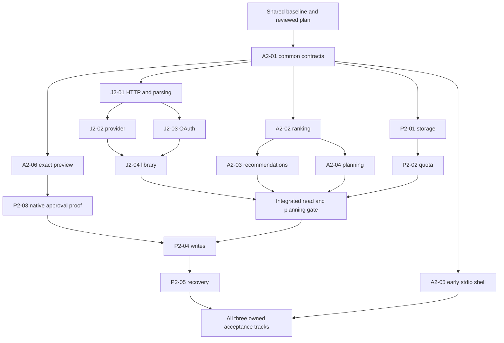

# Team implementation and delivery plan

Version 2.2 · 21 November 2026, revised as v2.3 on 28 November 2026 · Team Random Stuff · Author: Codex (v2.3 transfer note: Claude Code)

Current allocation: equal implementation ownership across Aadyant, Jeswin and Paul, with Aadyant as team lead and required reviewer for all teammate work. This user-directed revision supersedes the 16 November allocation and earlier chat prompts. It does not change the submitted SRS, product scope, technical safety rules or actual contribution history. Local preparation is not human review or completed implementation.

Read [MASTER_PLAN.md](MASTER_PLAN.md), [CONTRACTS.md](CONTRACTS.md), [AGENTS.md](../../AGENTS.md), your role brief, [TASK_MIGRATION.md](TASK_MIGRATION.md) and [REVIEW_POLICY.md](REVIEW_POLICY.md). Use **A2-01–A2-08, J2-01–J2-08 and P2-01–P2-08**. Earlier task IDs are retired. [tasks.json](tasks.json) is the machine-readable task/effort/dependency register; [coverage.csv](coverage.csv) maps the unchanged requirements. Real GitHub Issue/PR links remain pending until created.

Distilled basis: [lead-review governance](../../brain/resources/18-team-lead-review-governance.md), [equal team allocation](../../brain/resources/17-equal-team-allocation.md), [engineering workflow](../../brain/resources/12-engineering-and-knowledge-workflow.md), [implementation boundaries](../../brain/resources/15-implementation-boundaries-and-contracts.md).

## Solo completion transfer (v2.3, 28 November 2026)

**The remaining work now belongs to Aadyant.** On 28 November 2026,
Aadyant reported a team decision. J2-07, J2-08 and P2-08 move to him, along
with the release checklist and open exit criteria on merged slices. The
tables below keep the v2.2 allocation as history. `tasks.json` records
each transferred task's `implementer`. Transferred work uses the own-work
review mode: chosen AI review plus Aadyant's recorded human owner review.
Jeswin and Paul keep credit for their 20 merged tasks and write their own
reflections. Aadyant's planned implementation range grows to 70–100 h.
Written teammate acknowledgement is pending.
[ADR-0010](../adr/0010-solo-completion-ownership-transfer.md) ·
[decision note](../../brain/resources/20-solo-completion-ownership-transfer.md)

## 1. Equal workload and responsibility

| Member | Engineering track | Planned effort |
| --- | --- | --- |
| Aadyant Neog, BT2024186 | Common bootstrap/MCP, similarity and recommendations, strict playlist planning, shared presentation and product skill | 8 tasks; 56–80 hours; one third at midpoint |
| Jeswin Jose, BT2024142 | Validation/HTTP/provider, OAuth/secrets, authorised library retrieval, analytics, knowledge skills and privacy operations | 8 tasks; 56–80 hours; one third at midpoint |
| Paul T Mathew, BT2024135 | Durable repositories/retention, quota, native approval, playlist writes/recovery, CI and local-check/performance tooling | 8 tasks; 56–80 hours; one third at midpoint |

The equal split covers implementation effort and difficult decisions, not only task counts. Each owner implements production code, security/error paths, fixtures/tests/docs/integration and a demonstration, performs author self-checks, prepares handoffs and fixes feedback. The implementation estimate remains 168–240 team hours before contingency. Aadyant's additional centralized lead-review/coordination time and his own AI-assisted human verification remains author work: total workload is not claimed equal. Re-estimate at G1/G3; authors retain their own defect repair and integration responsibilities.

Every owner maintains their requirement/test/Issue/PR/note links and fixes their own defects. AI sessions name the actual AI author; each human writes their own reflection and commits under their own identity; Aadyant reviews all teammate work, with his chosen AI review and recorded human owner review for his authored/coauthored portions. No fabricated contribution or human approval is permitted.

## 2. Path ownership and interfaces

| Area | Primary owner | Collaboration rule |
| --- | --- | --- |
| Bootstrap, initial dependency locks, common DTO/error/protocol skeleton | Aadyant, A2-01 | Jeswin/Paul supply provider/account and quota/storage/approval technical input; Aadyant uses his chosen AI and records his own human owner review of the foundation PR |
| Ranking/profile/constraint/proposal domain; discovery/recommendation/planning services; presentation | Aadyant | No network, auth, database or approval side effects in domain/renderers |
| Identifier/duration/language parsing, HTTP/redaction, read provider/fixture dispatcher, OAuth/account, library and analytics | Jeswin | One accounted executor; auth uses Paul's deletion/repository interfaces; data snapshot contract is stable |
| SQLite/repositories/cache/clock/quota/workflow sessions, native approval, creation/recovery and write adapters | Paul | Uses Jeswin's executor/account service and Aadyant's exact proposal/renderer; no independent network or ranking implementation |
| `mcp/server.py`, common resources/CLI and client skill adapter | Aadyant | Feature owners supply their own service/handler integration and tests; composition ownership is not ownership of all integration |
| `mcp/discovery.py`, `mcp/planning.py`, recommendations handler | Aadyant | Guards use shared account/quota protocols |
| `mcp/library.py`, read/account/analysis handlers | Jeswin | Same schemas/bindings as common resources |
| `mcp/execution.py`, operation/quota/recovery handlers | Paul | Approval stays internal and write authority is checked at runtime |
| `providers/youtube.py`, `providers/fixture.py` read/dispatch core | Jeswin | Compose Paul's `youtube_writes.py` / `fixture_writes.py` through the common executor |
| CI/secret scan/shared denied-network tests; local-check and benchmark harness | Paul | All three supply their feature tests; CI calls Jeswin's knowledge validator |
| Brain-ingest/refine/query and knowledge validator; read-only scheduled live workflow | Jeswin | Every owner authors/updates their own knowledge and skill evidence; operator provisions live credentials |
| Video-to-playlist skill and feature/client walkthrough | Aadyant | Paul/Jeswin supply authority/data technical input; Aadyant uses his chosen AI plus his own recorded human review of the product skill |
| Fixture datasets, expected results, feature docs and evidence | Owner of the corresponding feature | Aadyant reviews teammate expected results and artefacts; owners retain fixture/docs implementation, with chosen-AI review and Aadyant's recorded human owner review for his own work |
| Common manifests/contracts/config, AGENTS, index/log and traceability | Shared with a named editor per PR | Coordinate exact edits; affected owners supply technical input and the required reviewer checks interface/dependency changes; append history without overwriting others |

Foundation interfaces: RequestContext/WorkflowPlan/QuotaLedger, YouTubeProvider, immutable LibrarySnapshot, Proposal/ResumeProposal, AccountService, TokenVault, ApprovalAdapter and repository deletion/expiry protocols. Publish examples and error cases in A2-01; no consumer invents a second representation of account, quota, duration or approval.

## 3. Work order and handoffs

1. **G0 together:** read the same plan/SRS, inspect existing changes/access, create real Issues, agree branches/reviewers and share this revised plan through a human-reviewed PR. Inspect the actual current implementation before claiming anything complete.
2. **Aadyant starts A2-01.** Jeswin and Paul provide contract-use requirements and technical input and prepare independent fixture/oracle/interface questions. They can prototype in isolated tests; consumer implementation merges against the reviewed shared contracts.
3. **After A2-01 merges, all three code in parallel:** Aadyant starts A2-06's preview and A2-05's stdio/client shell, then A2-02/A2-04; Jeswin starts J2-01 then J2-02/J2-03 (J2-05 pure analytics can also start from snapshots); Paul starts P2-01, proves P2-03 as soon as the preview exists, then P2-02. P2-06 CI scaffolding should start early once package commands exist.
4. **Read/proposal integration:** Jeswin delivers J2-04 snapshots; Aadyant integrates A2-03 recommendations and A2-04 planning; Jeswin integrates J2-05 reports. Paul verifies actual quota accounting and native approval against these shared objects. Do not wait for live credentials to develop fixtures.
5. **Writes and skills:** Paul implements P2-04 then P2-05. Aadyant completes A2-07's real product-skill evaluations; Jeswin completes J2-06 knowledge workflows and J2-07 privacy/live-check setup; Paul completes P2-07 local-check/measurement tooling. Use actual tools to evaluate skills, with human approval/rejection supervised.
6. **Final evidence together:** A2-08 owns feature/ranking/planning integration and measurements; J2-08 owns read/auth/analytics/privacy evidence; P2-08 owns writes/quota/recovery evidence and assembles the checked contributions. Aadyant reviews teammate release evidence and coordinates acceptance; he uses his chosen AI and records his own human review of his authored/coauthored portions. An agent cannot supply human approval or tag evidence.

Task dependencies below are prerequisites for the scoped implementation. `integration_requires` in tasks.json records additional real components needed before claiming integrated acceptance. Fake protocol dependencies are valid for isolated tests, never evidence that real integration passed. Large tasks have small reviewed slices: specifically A2-05 publishes the stdio/client shell early, and later registers feature-owner handlers as they land. A dependency on that shell does not require waiting for every final product route.

### Phase view

| Phase | Aadyant | Jeswin | Paul |
| --- | --- | --- | --- |
| Shared foundation | A2-01 package/contracts/smoke | Review provider/account interfaces; prepare parsing/oracles | Review quota/storage/approval interfaces; prepare fault oracles |
| Parallel foundations | A2-06 renderer; A2-05 early client shell; A2-02 ranking | J2-01 executor/parsing; J2-02 provider; J2-03 OAuth | P2-01 storage; P2-03 early native proof; P2-02 quota; early P2-06 CI |
| Read and proposal features | A2-03 recommendations; A2-04 proposals | J2-04 library; J2-05 analytics; J2-06 knowledge | Finish ledger/approval integration; P2-04 writes |
| Recovery and integration | Finish A2-05 routing; A2-07 product skill | J2-07 privacy/scheduled reads; integrate owned handlers | P2-05 recovery; P2-06 full CI; P2-07 local-check/harness |
| Acceptance/reviews | A2-08 feature evidence and reviews | J2-08 read/privacy evidence and reviews | P2-08 write/quota evidence and assembly |

Do not use the old sequence A01 → A02 → A05 from chat. New IDs and this three-track order replace it. No instructor date was supplied. At 15–20 hours per person per week, roughly four to seven weeks including contingency is a capacity illustration, not a promised delivery date; external blocks can extend it.

## 4. Aadyant's tasks

| ID | Effort | Prerequisites | Deliverable and scoped completion criteria |
| --- | --- | --- | --- |
| A2-01 | 6–8 h | G0 shared baseline checks | Complete G0 checks, package/runtime/dependency locks, strict common DTOs/errors and provider/quota/approval/repository protocols. Supply immutable synthetic contract examples and subprocess stdio initialise/tool/resource smoke. Obtain affected-owner technical input and chosen-AI review plus Aadyant's recorded human owner review of this foundation; publish the contract PR before consumers merge. |
| A2-02 | 10–14 h | A2-01 | Implement FR-1/FR-2 bounded candidate discovery, TF-IDF/cosine, category evidence, deterministic ties and channel sampling. Own ranking/discovery fixtures, independent topical expectations, service tests and feature MCP handlers. Integration uses Jeswin's provider and Paul's reserved contexts. |
| A2-03 | 6–8 h | A2-02 | Implement FR-3 profile weighting, shared-vector-space ranking, profile exclusions, sparse-source handling and explicit filters. Consume LibrarySnapshot without fetching data inside the domain. Own profile/recommendation fixtures, reasons, unit/service tests and recommendation handler. |
| A2-04 | 8–12 h | A2-01, A2-02 | Implement FR-5 clarification/validation, strict topic/audio-language/duration eligibility, deterministic packing, immutable proposal digest/version/revision and expiry. Use common parsing/account/repository protocols. Own boundary/property tests and planning handler; no playlist writes. |
| A2-05 | 8–12 h | A2-01 | Build shared server/CLI/resource routing, strict structured/text output, account guards, progress/cancellation and canonical skill adapter. Coordinate feature-owned handler modules instead of implementing everyone's services. Prove selected-client stdio/resources early; complete registration as owners supply handlers. |
| A2-06 | 6–8 h | A2-01 | Implement escaped ranked results, complete proposal/resume previews, analytics report rendering and actionable errors from public DTOs. Preserve authoritative totals/evidence, show all items/account/privacy/expiry and fixture labels. Supply early preview examples to Paul's native dialog. |
| A2-07 | 5–7 h | A2-02, A2-04, A2-05 | Author/evaluate video-to-playlist, including composed quota session before seed fetch, metadata-only summary, clarification, exact preview, human rejection/approval and actual result analysis. Own feature/ranking/planning user docs and selected-client skill walkthrough; no automated live approval. |
| A2-08 | 7–11 h | A2-03, A2-04, A2-05, A2-06, A2-07, J2-04, P2-05 | Integrate and demonstrate FR-1/FR-2/FR-3/planning through real stdio, measure ranking/planning targets, resolve own defects, update own traceability and maintain Aadyant's ongoing review/acceptance record for all teammate deliverables (lead-review time tracked separately). Supply feature release evidence and an individually authored human reflection; do not absorb teammate work. |

## 5. Jeswin's tasks

| ID | Effort | Prerequisites | Deliverable and scoped completion criteria |
| --- | --- | --- | --- |
| J2-01 | 8–12 h | A2-01 | Implement supported URL/ID, exact ISO duration and language-tag parsing plus HTTPS route allowlist, timeouts, cancellation, redaction and bounded safe read retries. Debit before dispatch through QuotaLedger; use a fake ledger in offline unit tests until real integration. No hidden retry or write retry. |
| J2-02 | 10–14 h | J2-01 | Implement official read methods, batching/pagination/omissions/category labels and the fixture provider dispatch/error engine. Own read API-shaped fixtures and contract tests. Compose Paul's separate write adapters/fixture-write script support through the same executor; never fall through from fixtures to live. |
| J2-03 | 10–14 h | J2-01 | Implement installed-app PKCE/state flow, verified protected vault, refresh/granted scopes/channel binding and scope upgrade. Disconnect orchestrates revocation and account-data deletion through Paul's repositories. Own isolation/redaction/denied-scope/missing-channel tests and consent/privacy docs. |
| J2-04 | 8–12 h | J2-02, J2-03 | Retrieve likes/subscriptions/owned playlists with source fairness, bounded nested pages/samples, dedup/source memberships and private opaque continuation. Produce immutable snapshots for Aadyant's profile and analytics. Own library fixtures, coverage/denial tests and library/account MCP handlers. |
| J2-05 | 8–10 h | A2-01 | Implement FR-4 pure source/unique summaries, denominators, runtime bands/mean/median and separate subscription counts. Compare allowed events over non-overlapping UTC intervals, with unknown like dates and zero baselines disclosed. Own hand-calculated oracles, analytics service/handler and tests. |
| J2-06 | 4–6 h | A2-01 | Maintain brain-ingest; implement brain-refine and brain-query, their positive/negative/evidence cases, and note/skill/link/traceability validation. Preserve source/authorship/history. Expose a stable validation command for Paul's CI; all owners maintain their own notes and skills. |
| J2-07 | 4–6 h | J2-02, J2-03, P2-06 | Document clean-checkout consent/disconnect, retention/AI-client disclosure, token recovery and D-02 status. Prepare a separately scheduled protected-runner read-only workflow with fixed budget and honest blocked prerequisites. Operator provisions credentials; no live writes or unattended approval. |
| J2-08 | 4–6 h | J2-04, J2-05, J2-06, J2-07, A2-05, P2-01, P2-02 | Prove HTTP/account/library/analytics integration with real SQLite/quota and stdio, verify disconnect/retention, show FR-4 and read failures, update own traceability and submit all read/privacy deliverables to Aadyant, resolving his findings; do not review Aadyant's PRs; he uses chosen-AI review plus his recorded human owner review. Supply read/privacy release evidence and own human reflection; no fabricated live result. |

## 6. Paul's tasks

| ID | Effort | Prerequisites | Deliverable and scoped completion criteria |
| --- | --- | --- | --- |
| P2-01 | 8–12 h | A2-01 | Implement migrations, private account-bound repositories, operation intent storage, clock/cache, TTL/hard deletion and minimal replay tombstones. Protect runtime paths outside git and preserve project quota on account deletion. Publish deletion/repository interfaces for Jeswin and Aadyant with simulated-time/restart tests. |
| P2-02 | 10–14 h | P2-01 | Implement dated general/search profiles, project-scoped atomic reserve/spend/release, conservative crash accounting, Pacific DST reset and full composed-workflow sessions. Prove insufficient budget rejects before seed/provider calls, concurrent requests cannot overspend and changed profiles/restarts fail safely. |
| P2-03 | 6–8 h | A2-01, A2-06 | Prove helper/client lifecycle early using the fixture stdio skeleton and full preview, then implement challenge-bound human decisions and internal one-use account/digest/operation grants. Reject close/timeout/forgery/headless paths with zero writes. No client/model automation may operate a live control. |
| P2-04 | 10–14 h | P2-01, P2-02, P2-03, A2-04, J2-02, J2-03 | Implement exact approved write bodies through Jeswin's executor, operation claim, preflight/revalidation, intent-before-dispatch, serial insertions, final verification and partial/unknown status. Own live-write adapter, fixture write-state engine/scenarios, execution MCP handler and fault/security tests; never auto-retry writes. |
| P2-05 | 8–12 h | P2-04 | Implement replay safety, restart and ambiguous create/item reconciliation, verified-prefix/missing-suffix resume proposals with fresh approval and expired-result handling. Own independent fault matrix, repeated-operation MCP tests, recovery documentation and honest unknown/manual-action paths. |
| P2-06 | 4–6 h | A2-01 | Implement locked Windows/Linux PR build/lint/type/offline test/secret checks, shared denied-network test setup, PR template and lead-review policy enforcement design using verified actual accounts. Cover Aadyant's required approval for teammate work and chosen-AI review plus Aadyant's recorded human owner review of his authored/coauthored portions, without inventing independent GitHub approval or bypassing protections; configuration evidence remains pending until verified. Run Jeswin's knowledge validator once available; pin actions/scanners and keep untrusted PRs credential-free. Each owner supplies their own feature fixtures/tests. |
| P2-07 | 4–6 h | A2-05, P2-06, J2-02 | Implement/evaluate local-check with separate build/tests/start/read-only MCP fetch/cleanup statuses. Supply reusable one-warm-up/30-run performance harness and safe evidence format; owners run their own target measurements. Fixture default, explicit live quota disclosure and no automated human approval. |
| P2-08 | 6–8 h | P2-02, P2-05, P2-06, P2-07, A2-08, J2-08 | Demonstrate approved/rejected/replayed/partial/unknown write and quota scenarios through stdio, resolve own defects, update own traceability and submit write/quota/recovery deliverables to Aadyant for review. Assemble owners' release evidence for his lead acceptance; do not review Aadyant's PRs; his workflow uses chosen-AI review plus his recorded human owner review. Actual reviews/tag remain human actions. Provide own human reflection. |

## 7. Dependencies and delivery gates

The diagram is a principal integration view; tasks.json contains the exact implementation prerequisites and integration requirements, including analytics, CI and skills omitted from the compact diagram. Check both sets at the relevant gate. Cross-track calls share interfaces and test doubles until real components are ready, then actual integration must pass.

| Gate | Exit evidence |
| --- | --- |
| G0 Reviewed allocation/baseline | Same revised docs, real Issues/identities/access and task branches; unchanged SRS; historical allocation explicitly superseded |
| G1 Shared contracts and client/authority feasibility | A2-01 merged; A2-05 shell/client proof; A2-06 exact preview; P2-03 human rejection/expiry/lifecycle proof. Protocol and native trust remain blockers until demonstrated |
| G2 Accounted provider foundations | J2-01/J2-02/J2-03 + P2-01/P2-02 integrated; secure identity/storage and real quota debit-before-dispatch; offline CI basics from P2-06 |
| G3 Read features and strict proposals | A2-02/A2-03/A2-04/A2-06 + J2-04/J2-05 work through stdio with actual fixture provider/storage/quota; no assumed watch history or fabricated language |
| G4 Write/recovery and skill safety | P2-03/P2-04/P2-05 plus A2-07/J2-06/P2-06/P2-07 pass applicable real offline security/fault/skill evaluations; zero writes for refusal/forgery/replay; unknown outcomes disclosed |
| G5 Actual acceptance/submission | A2-08/J2-07/J2-08/P2-08 supply measured/observed evidence, resolved live dependencies, all 46 requirements/20 ATs/TQ/SK mapped, actual human reviews and release artefacts |

SRS stage alignment remains: Stage 1 SRS/vault/AGENTS/repository/CI skeleton; Stage 2 reviewed architecture/ADRs/diagrams and brain-refine/query/local-check; Stage 3 tested CI/skills/defects/regressions and stage reviews; Stage 4 live five-feature/skill walkthrough, traced evidence, final human review/tag/changelog. Functional gates do not replace instructor submissions. Unresolved D-02, credentials, runner or trusted human approval remains blocked, never passed.

## 8. Commits, review and integration responsibility

- Claim one dependency-ready task Issue; branch from reviewed main using `codex/<v2-task-id>-<purpose>` for agent work. Do not push directly to main or overwrite teammates' work.
- Commit regularly after coherent verified steps and before switching tasks or handing off. Stage only intended changes, reference the task/Issue and use descriptive messages. Do not hold an entire task/project for one final commit. Preserve unrelated local edits.
- Each task owner writes/runs their necessary tests, supplies independent synthetic fixtures/oracles, integrates their service/handler, maintains docs/traceability and repairs defects. Use real stdio tests for protocol behaviour and real components for final integration; passing a fake is not the latter.
- Aadyant is the required reviewer of every Jeswin/Paul PR and deliverable. Neither teammate is assigned to his PRs: he uses his selected AI reviewer and records his own actual human owner review of the exact changes. No AI output or owner self-check is labelled independent GitHub approval; no human review is fabricated.
- Coordinate one editor per shared manifest/contract/index/log change. Affected owners give technical input; the required reviewer checks the contract delta before acceptance. Shared ownership does not mean simultaneous uncoordinated writes.
- Aadyant coordinates the review queue, handoffs and stage/release acceptance. Jeswin reports read/privacy readiness and Paul reports write/recovery readiness/assembles evidence; owners supply and fix their portions. Lead review does not transfer authorship or all integration fixes to Aadyant.
- A PR/deliverable handoff lists task, exact commit/artefact version, changed behaviour/files, actual checks, requirement/Issue/PR/test/skill/note links and remaining blocks. Teammates submit it to Aadyant; record his actual current-version decision/link, fix feedback and request re-review after material changes. Do not mark unreviewed work accepted or merge without the required human review.

## 9. Evidence and workload checkpoints

At G1/G3 and each weekly checkpoint Aadyant compares implementation effort, completed complexity, defects/integration and his separately recorded review/coordination load; his AI-review findings and personal human verification are recorded as author evidence. If one track exceeds the others materially (for example by over 15% of remaining estimated effort), explicitly redistribute a bounded unstarted task or reduce that person's other obligations and update all task/ownership/coverage documents. Do not silently move work or remove required scope. Review counts and hours support judgement; they do not override the actual difficulty or quality of the work.

Each owner contributes their scoped docs/evidence: date, mode, commit, runtime/client versions, inputs, expected/observed results, pass/fail/blocked, fixture IDs, actual timings/quota where required, limitations and real links. No secrets/private payloads in git. All three personally author a human reflection and explain their implementation. Before a stage submission, each checks their own skills/requirements and the team produces a real stage review.

## 10. Copyable prompts for each coding agent

Aadyant:

> Read root AGENTS.md and the version 2 master plan, contracts, team workplan, tasks.json, coverage and roles/AADYANT.md. Start with A2-01 after G0 checks, then choose a dependency-ready A2 task. Own ranking/recommendations/planning/MCP/presentation and video-to-playlist. Jeswin and Paul own equally substantial tracks; request their interfaces and integrate your own handlers without taking over their work. Commit regularly, track lead-review/coordination time separately, review every teammate deliverable and prepare your own PR for AI-assisted review and Aadyant's recorded human owner review. Earlier A01–A12 prompts are retired.

Jeswin:

> Read root AGENTS.md and the version 2 implementation documents plus roles/JESWIN.md. After A2-01 contracts merge, start J2-01; use isolated contract fixtures while real ledger/storage components develop. Own HTTP/read provider/OAuth/library/analytics, knowledge skills and privacy/live-read setup. Implement your own tests/docs/handler integration, commit regularly and submit every PR/deliverable to team lead Aadyant for actual review, fixing findings and returning material changes for re-review. Never bypass quota, protected credentials or human write approval. Earlier J01–J04 prompts are retired.

Paul:

> Read root AGENTS.md and the version 2 implementation documents plus roles/PAUL.md. After A2-01 contracts merge, start P2-01; prove P2-03 as soon as A2-06 preview exists, develop P2-02 quota and early P2-06 CI. Own durable storage/quota/native approval/playlist writes/recovery, local-check and benchmark tooling. Use Jeswin's accounted executor and Aadyant's exact proposals. Commit regularly, test crash/authority failures, integrate your own handlers and submit every PR/deliverable and actual evidence to team lead Aadyant for review and re-review after material changes. Never automate human confirmation. Earlier P01–P04 prompts are retired.

Reusable continuation:

> Inspect the reviewed current branch and version 2 tasks.json. Work on [V2 TASK ID] only after its prerequisites/interfaces are ready. Preserve existing edits, stay within the shared ownership rules, commit coherent verified steps and report actual tests, integration status and pending links. Prepare the exact-version handoff for Aadyant's review of teammate work, or his chosen AI review and recorded human owner review for his own work; never infer or fabricate approval.

Current own-work review clarification: [source note 19](../../brain/resources/19-owner-ai-assisted-review-and-submitted-srs.md); [review policy](REVIEW_POLICY.md). No Jeswin/Paul assignment to Aadyant PRs; the human-review baseline is retained.
