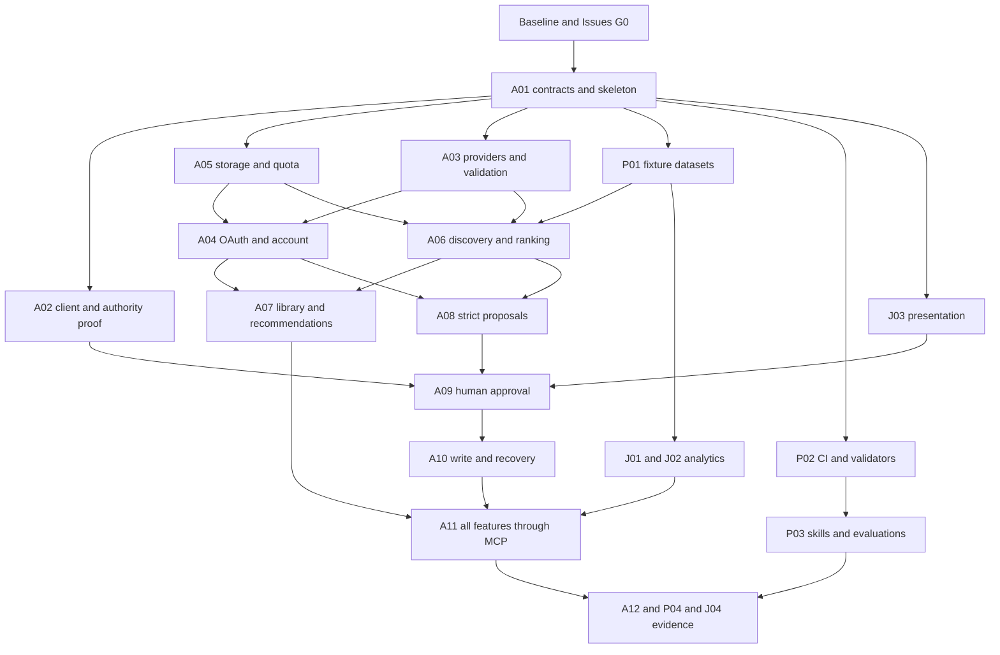

# Team implementation and delivery plan

Version 1.0 · 16 November 2026 · Team Random Stuff · Local proposal; no assignment has been accepted or completed by a teammate merely because it appears here.

Follow [MASTER_PLAN.md](MASTER_PLAN.md), [CONTRACTS.md](CONTRACTS.md) and [AGENTS.md](../../AGENTS.md). Task IDs below are local planning IDs, not existing GitHub Issues. Create real Issues and add links before implementation PRs. Proposed test paths are targets, not evidence that tests exist or passed.

Basis: [engineering workflow](../../brain/resources/12-engineering-and-knowledge-workflow.md) and [implementation boundaries](../../brain/resources/15-implementation-boundaries-and-contracts.md).

## 1. Ownership and workload

| Person | Responsibility | Why the assignment fits |
| --- | --- | --- |
| Aadyant Neog, BT2024186 | Architecture/contracts, official API provider, OAuth/secrets, persistence/quota, FR-1/2/3, FR-5 planner/approval/write recovery, MCP integration and release integration | Holds the difficult algorithms, security boundaries and bulk of implementation |
| Jeswin Jose, BT2024142 | FR-4 pure analytics, period comparisons, readable result/preview/report formatting, relevant unit tests and user examples | Substantive product code on stable inputs, without network/auth/recovery complexity |
| Paul T Mathew, BT2024135 | Independent synthetic fixture datasets/oracles, offline CI and knowledge validation, skill workflows/evaluations, setup/recovery docs and evidence organisation | Bounded infrastructure and workflow contributions with concrete deliverables |

Estimated implementation effort, including task-specific tests and documentation: **Aadyant 96–140 hours, Jeswin 20–28 hours, Paul 22–30 hours**. At midpoint Aadyant carries about 70% of the work and most of its complexity. These estimates are planning ranges, not measured productivity or grading promises. Add 20–30% team contingency for integration, defect repair, reviews and external setup. No calendar deadline was supplied.

Every teammate must explain their code, run its checks, provide an attributable contribution and participate in human review. A smaller workload does not mean a fabricated contribution. The user requested this allocation; do not quietly redistribute core work to teammates or do their tasks under their names.

### Path ownership

| Paths | Primary owner | Shared-change rule |
| --- | --- | --- |
| `src/yt_intel/contracts/`, `domain/`, `services/`, `providers/`, `infrastructure/`, `auth/`, `approval/`, `mcp/`, bootstrap/config/CLI | Aadyant | Interface/security changes need an explicit contract/ADR update and human review |
| `src/yt_intel/analytics/`, `src/yt_intel/presentation/`, corresponding `tests/unit/analytics/` and `tests/unit/presentation/` | Jeswin | Consume merged DTOs; request upstream fields instead of inventing them |
| `tests/fixtures/`, `tests/skills/`, knowledge/skill/local-check scripts, CI workflows, `docs/user/`, client setup examples, new workflow skills | Paul | Aadyant reviews security/live/shared-tool assumptions; Jeswin reviews analytics fixture expectations |
| `pyproject.toml`, locks, root `AGENTS.md`, implementation plan, shared `tests/conftest.py`, SRS traceability/index/log | Aadyant integrates | Agree shared edits in the Issue/PR; others propose focused patches rather than overwrite |
| Individual notes/session records, stage-review content | Actual author | AI sessions name the AI; human reflections are written by the human |

Ownership coordinates work and review; it does not prevent a legitimate reviewed fix. Each owner handles their defects. Never weaken tests, increase budgets or bypass approval to finish a task.

## 2. Aadyant's engineering tasks

| ID | Effort | Dependencies | Concrete deliverable and definition of done |
| --- | --- | --- | --- |
| A01 | 6–8 h | G0 baseline inspection | Package/locked environment, composition skeleton, Pydantic contracts, example DTOs/errors/provider protocol, fixture-mode stdio initialise/tool/resource smoke. Verify chosen SDK release/protocol compatibility. Publish dependency record and contract PR; consumers can import the wheel/package. |
| A02 | 4–6 h | A01 minimum server | Windows client/skill/native-dialog proof. Demonstrate actual local stdio connection, complete human preview and reject/close producing zero writes. Test helper availability/lifecycle, restrictions on automation, and selected-client skill loading. Record blocked prerequisites honestly. |
| A03 | 8–12 h | A01; A05 execution accounting before live calls | ID/URL/duration/language validation, live HTTP executor and YouTube provider mappings; fixture provider normaliser/script runner. Mock HTTP tests cover allowlist, batches/pages, omissions, errors, timeouts, no hidden retries. |
| A04 | 8–12 h | A01; A03/A05 for channel verification | Installed-app OAuth with PKCE/state, protected vault, granted-scope checks, channel binding, refresh and disconnect/deletion. Fake vault/HTTP tests; Windows protected-backend manual proof in authorised local setup. No secrets committed or emitted. |
| A05 | 10–14 h | A01 | SQLite migrations/repositories, cache expiry/cleanup, project-scoped quota profile/ledger, `WorkflowPlan` and composed workflow sessions. Transaction/restart/DST/concurrency tests prove full-cost reservation and zero calls on insufficient budget, including rejection before the first seed fetch in a multi-tool product skill. A03 may use a fake executor while this lands. |
| A06 | 8–12 h | A03, A05, P01 discovery fixtures | FR-1/2 candidate discovery, versioned TF-IDF/scoring, bounded channel samples, stable explanations/ties and coverage. Domain and MCP system tests for AT-02/03; policy gate applies to live derived processing. |
| A07 | 10–14 h | A03–A05, A06 ranking primitive, P01 library fixtures | Budgeted likes/subscriptions/owned-playlist snapshots with continuation, dedup/source membership, recommendation profile and FR-3. Denied/sparse-source and all-signal tests; stable snapshot handoff to Jeswin. |
| A08 | 8–10 h | A06, contracts; A04 for account binding | FR-5 structured interpretation validation, topic/audio-language/duration hard filters, deterministic bounded selection, immutable proposal digest/version/expiry/revision. Property/boundary tests and complete preview DTO; no provider writes. |
| A09 | 6–10 h | A02, A04, A05, A08, J03 preview rendering | Production native approval adapter/helper, one-use operation/digest/account-bound grants, cancellation/expiry/forgery defences. Approval tests verify no model input/test flag can grant live consent. |
| A10 | 14–20 h | A03–A05, A08–A09 | Serial playlist creation and durable intent journal, final verification, partial/unknown responses, crash/restart reconciliation, safe human-assisted unknown-create handling and renewed approval for resume. Fault injection at each boundary; AT-08/09/12/13 regression cases. |
| A11 | 8–12 h | A06–A10, J01–J03, P02/P03 available increments | Finish MCP tools/resources/services wiring; account/policy checks on every surface, readable structured outputs, process/deadline/cancellation handling, full offline AT-01–AT-16 and skill integration. No tool/schema drift. |
| A12 | 6–10 h | A11, P04, J04 | Performance evidence, authorised quota-budgeted live verification, stage/final traceability inspection, defect fixes and release integration. External blocks recorded; no release until all mandatory evidence is satisfied. Human review/release actions remain genuine team actions. |

A04/A05/A03 are mutually integrated slices, not a circular dependency: A01 defines interfaces; A05 implements fake-driven persistence/accounting independently; A03 uses test doubles until real accounting is ready; A04 uses mocked identity/provider responses before live channel verification. Do not enable live traffic during that intermediate state.

## 3. Jeswin's bounded product tasks

| ID | Effort | Dependencies | Concrete deliverable and definition of done |
| --- | --- | --- | --- |
| J01 | 6–8 h | Merged A01 contracts, P01 initial datasets; A07 not required for pure tests | Implement source/unique composition, channel/category counts, unknowns, runtime mean/median/bands and subscription-channel summaries. Tests use a hand-calculated oracle and assert denominators/dedup rules. Code takes an immutable snapshot and imports no provider/auth/SQLite modules. |
| J02 | 5–7 h | J01 model familiarity, event fixtures | Implement two non-overlapping UTC interval comparisons using allowed event types. Test start/end boundaries, adjacent versus overlapping periods, empty periods, missing dates and zero baseline. Like-event trends explicitly unavailable. |
| J03 | 6–8 h | A01 public DTOs, A08 proposal example; can begin from contract fixture | Implement readable ranked results, full proposal previews, report tables and actionable error text. Escape metadata and show all approved items, account/privacy, exact/display totals and warnings. Snapshot/targeted tests check semantic content rather than brittle whitespace. Supply the renderer used by native approval. |
| J04 | 3–5 h | J01–J03 integrated via A11 | Write analytics examples/limitations, verify Windows client presentation, explain FR-4 in the demo, and author own human note/review. Correct own defects and link actual test/PR evidence. |

Start J01/J02 using synthetic contract fixtures while Aadyant implements retrieval. Do not wait for real Google credentials. If the snapshot lacks a field, file a contract question with a minimal example; do not call the API from analytics or read another account's files.

## 4. Paul's bounded quality/workflow tasks

| ID | Effort | Dependencies | Concrete deliverable and definition of done |
| --- | --- | --- | --- |
| P01 | 5–7 h | A01 model examples; oracle drafting can start earlier | Synthetic API-shaped video/channel/library/pages and failure manifests with expected outputs authored independently of algorithms. Include private/deleted/omitted metadata, 1,200/1,201-second items, wrong/unknown language, duplicate sources, injection text and partial/unknown writes. Fixture schema validation and no private data. Aadyant implements provider mechanics. |
| P02 | 5–7 h | A01 working package/check commands | PR CI on Windows/Linux fixtures, build/lint/type/unit/integration/system/secret checks, note/skill/link/traceability validator, PR template and ownership configuration. Test deliberate invalid note/link/skill/secret-shaped synthetic examples safely; real secrets never used. GitHub-run evidence only when actual workflows run. |
| P03 | 6–8 h | A01, P02; A06/A08/A10 for full product evaluation | Maintain brain-ingest; implement brain-refine, brain-query, local-check and video-to-playlist SKILL.md workflows, client adapter and evaluations. local-check starts/stops its fixture subprocess and fetches via MCP. Evaluate success, negative and authority/evidence cases; do not automate human approval. Aadyant reviews write-related instructions. |
| P04 | 6–8 h | A02 setup findings; A11/J04 for final evidence | Setup/privacy/recovery/client/tool docs, separately scheduled budgeted read-only live-workflow configuration, performance-report harness, stage-evidence folders and demo checklist. Verify setup from a clean checkout. Explain own fixtures/CI/skills contribution; author own human note/review. Credentials/runner/policy setup remains Aadyant's/operator action. |

Automated skill validators prove file/schema integrity and deterministic workflow steps; they do not prove the client followed a conversational skill correctly. P03 includes actual selected-client observed evaluations, with human approval/rejection cases supervised. Record unperformed cases as blocked/pending instead of generating a pass table.

## 5. Dependency graph and integration gates

The graph shows principal dependencies; task tables retain additional checks. Aadyant remains the critical path. Teammates work in their own branches/checkouts and integrate against merged contracts rather than editing his uncommitted files.

| Gate | Required outcome before declaring it complete |
| --- | --- |
| G0 Baseline/workflow | Read SRS and brain; inspect existing edits; create real task/dependency Issues; verify members' actual access/identity, branch protection and baseline hashes. Existing Stage 1 CI/human evidence gaps are visible. |
| G1 Contracts and feasibility | A01 and A02 reviewed; package/bootstrap works; selected-client stdio/resources and skills proven; native confirmation authority/lifecycle tested. Jeswin/Paul can start independent work. D-02 clarification requested/tracked. |
| G2 Foundations and discovery | A03–A06 plus P01/P02 pass applicable offline checks. Inputs, HTTP allowlist, OAuth mocked failures, SQLite/quota/restart/concurrency and FR-1/2 complete through MCP. No live-derived claim while D-02 unresolved. |
| G3 Read features and planning | A07/A08 and J01–J03 pass; FR-1/2/3/4 plus strict proposals function end-to-end in fixtures. Full preview is stable and trusted renderer shared. |
| G4 Writes and failure safety | A09–A11 pass negative/security/fault-recovery tests through MCP; complete/reject/replay/partial/unknown scenarios demonstrated with synthetic provider. P03 skill evaluations are real observed records. |
| G5 Live and submission evidence | A12/J04/P04; policy/account/client prerequisites resolved, authorised live FR-1–FR-5/skills and scheduled checks evidenced, NFR targets measured, traceability and human PR reviews complete, instructor stage checklist satisfied. Missing live evidence is a block. |

A rough five-to-seven-week envelope at Aadyant's 20–30 hours/week: week 1 contracts/spikes/fixtures; weeks 2–3 foundations/discovery/library and parallel analytics/CI; weeks 4–5 planning/approval/recovery/skills; weeks 6–7 integration/live/defects/reviews as needed. This is conditional capacity planning. Re-estimate after G1 and G3; do not shrink required tests to fit an unsupported date.

### SRS stage alignment

Stage 1: preserve current SRS, notes and AGENTS; finish any real repository/CI-skeleton/human-review gaps. Stage 2: reviewed architecture/UML/ER/state/sequence diagrams and ADRs, brain-refine/query and initial local-check. Stage 3: automated testing/CI results, evaluated product skill, defects/regressions and stage review. Stage 4: live five-feature/skill walkthrough, traceability, release/tag/changelog and final review. Functional gates help implementation; they do not replace instructor stage submissions.

## 6. Branch, Issue, PR and review protocol

1. An owner claims one task Issue with requirements, scope, dependencies, intended files, expected tests and open questions. Use actual GitHub links; never substitute `A07` for a real Issue URL in traceability.
2. Branch from current reviewed `main` using `codex/<task-id>-<short-purpose>` for agent work, or the team's agreed human branch convention. One active owner per implementation area. Avoid a shared working directory for simultaneous agent edits.
3. Keep task-sized incremental commits. Security-sensitive tasks may use multiple reviewable PRs, such as quota storage then accounting tests, or write journalling then reconciliation. No direct pushes to protected main and no force pushes to teammates' branches.
4. Run scoped checks, then required PR checks. Update the requirement register with the actual implementation test path and Issue/PR links, add/update a distilled note/ADR when needed, and record significant AI sessions honestly. Shared index/log changes are appended and conflict-resolved without erasing others' entries.
5. PR body states trigger/problem, resulting behaviour, tests actually run, remaining blocks, requirements and risks. At least one actual human other than the author reviews. AI review assists but never supplies the human approval.
6. Aadyant integrates shared contract/dependency changes and keeps consumers compatible. Merge only after checks and review; preserve attributable commit authors. Do not merge, publish, tag or send messages on someone's behalf without appropriate session authority.

Suggested reviewers: Jeswin reviews Aadyant's discovery/profile/results against fixtures; Paul reviews Aadyant's quota/approval/recovery acceptance evidence using documented invariants; Aadyant reviews Jeswin's arithmetic/DTO use and Paul's CI/skills/live-workflow permissions. Reviewers ask the author to demonstrate unclear code. A superficial approval is not a substitute for understanding; get additional instructor help if a critical boundary remains uncertain.

## 7. Task completion and evidence format

Every task closes only when its scoped code/docs exist, necessary tests pass, expected limitations are documented, real links are present, a human PR review occurred and the owner can explain the result. Planning checks do not close implementation tasks. Broken CI, secret exposure, approval bypass, cross-account access or duplicate writes block release.

Evidence records under `docs/evidence/<stage-or-feature>/` should contain: date, mode, commit, runtime/client versions, synthetic fixture identifiers or redacted live configuration, commands/inputs, expected/observed results, pass/fail/blocked per step, elapsed/quota values where relevant, limitations, owner and review/Issue/PR links. Capture no tokens, callback URLs, private library dumps or raw account identifiers unnecessarily. Keep live account-specific screenshots/exports out of git unless safely anonymised and actually authorised.

Before each stage, Paul checks evaluation records and knowledge validity; owners repair their paths; the team writes an actual stage review. Before release, Aadyant checks all 46 requirement rows, all 20 ATs, TQ-1–TQ-8, SK-01–SK-06, human identities/reviews, changelog and a reviewed release tag. Do not call any of these complete because this document lists them.

## 8. Copyable teammate prompts

Give Jeswin's agent this instruction with his actual task Issue:

> Read root AGENTS.md, docs/requirements/SRS.md, brain/index.md, docs/implementation/MASTER_PLAN.md, CONTRACTS.md, TEAM_WORKPLAN.md and roles/JESWIN.md. Work on my assigned J-task only, starting from merged contracts. Own analytics/presentation and their tests. Use synthetic snapshots, no YouTube/OAuth/database/approval changes. Inspect git status and preserve existing edits. If a required shared field is absent, propose a contract change instead of inventing an API. Report actual checks and pending links. Attribute AI notes to the AI and leave human review to humans.

Give Paul's agent:

> Read root AGENTS.md, docs/requirements/SRS.md, brain/index.md, docs/implementation/MASTER_PLAN.md, CONTRACTS.md, TEAM_WORKPLAN.md and roles/PAUL.md. Work on my assigned P-task only. Own synthetic fixtures, workflow/knowledge checks, skills/evaluations and docs in the allowed paths. Do not change production ranking/provider/auth/quota/approval/recovery or claim a scheduled live run happened. Keep PR CI offline; live credentials/configuration belong to the operator. Run the relevant checks and record pass/fail/blocked honestly. Never automate human playlist confirmation or human PR approval.

For Aadyant's coding agent:

> Read root AGENTS.md and the implementation documents, then work on the next dependency-ready A-task from roles/AADYANT.md. Preserve the SRS and existing document edits. Establish contracts and early client/approval feasibility first. Build fixture-driven security/quota/recovery tests with the implementation. Keep shared interfaces stable for Jeswin and Paul, and do not silently take over their contributions. Mark external policy/live/review dependencies blocked rather than passed.
